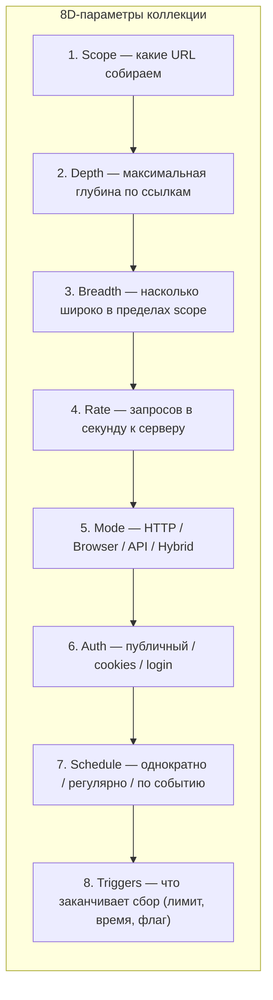

# Стратегии сбора архивов сайтов

Запуск кроулера — это 5 минут. Правильно выбранная **стратегия** — это десять решений, которые определят качество и размер архива через неделю работы. Не существует «правильного» способа собирать сайт — есть диапазон подходов от минимального «только главную» до исчерпывающего «всё включая CSS-псевдоэлементы».

> **Эта страница** — методическая. Конкретные команды — на страницах инструментов ([Wget](/kb/instruments/tools/wget), [Browsertrix](/kb/instruments/tools/browsertrix), [wparc](/kb/instruments/ruarxive-tools/wparc)). Здесь — принципы.

## Размерность стратегии

Любую стратегию описывают 8 параметров:



Хорошая стратегия фиксирует все 8.

## Параметр 1: Scope

### «Что именно мы собираем?»

| Scope | Что включает | Когда использовать |
|:---|:---|:---|
| **Single page** | 1 конкретный URL | Цитата, страховка |
| **Section** | Раздел сайта (`/news/`) | Тематическая архивация |
| **Whole site** | Весь сайт по sitemap | Полная страховка сайта |
| **Domain** | Весь домен + поддомены | Организация, портал |
| **Multi-domain** | Несколько связанных доменов | Медиахолдинг, гос. холдинг |
| **TimeSlice** | Только диапазон дат (например, 2020–2024) | Ретроспектива |

### Как определить scope

**Алгоритм:**

1. **Скачать sitemap.xml.** Для крупных сайтов — обязательно. Через `curl` или `wget`:
   ```bash
   curl https://example.com/sitemap.xml > sitemap.xml
   ```
2. **Посмотреть robots.txt.** Там могут быть закрытые разделы:
   ```bash
   curl https://example.com/robots.txt
   ```
3. **Пройтись по sitemap глазами** — увидеть структуру, прикинуть размер.
4. **Решить границы** — включаем `https://example.com/news/*` или весь `https://example.com/*`?

### Типичные scope

```text
# Только раздел новостей
https://example.com/news/

# Весь сайт, без админки
https://example.com/  --exclude /admin, /user, /login

# Домен + поддомены
*.example.com

# Несколько доменов одной организации
example.com example.org example.ru
```

## Параметр 2: Depth (глубина)

Глубина — максимальное число «кликов» от seed-страницы.

| Depth | Что получим | Число страниц (очень приблизительно) |
|:---:|:---|:---:|
| 0 | Только seed-URL | 1 |
| 1 | Seed + прямые ссылки | 10–50 |
| 2 | + ссылки с тех страниц | 100–500 |
| 3 | + ещё один уровень | 1 000–5 000 |
| ∞ | Все достижимые | зависит |

### Правила выбора глубины

- **Новостной сайт** — глубина зависит от того, как устроены архив и пагинация: материалы за прошлые годы часто доступны только через многостраничные списки, поэтому нужна большая глубина или обход по sitemap.
- **Корпоративный сайт** — небольшой глубины (`depth=2`–`3`) часто достаточно, но проверяйте покрытие по sitemap.
- **Форум** — часто требует `depth=∞` с фильтром по дате (т. к. темы ссылаются друг на друга).
- **SPA** — кроулер не идёт «глубиной», потому что JS рендерит всё с одной страницы; используйте **behaviors** (autoscroll).

### Превышение бюджета

Что делать, когда depth=∞ собирает 100 000 страниц и не заканчивается:

- Установить `max_pages` (например, 50 000).
- Установить `max_size` (например, 50 ГБ).
- Установить `max_duration` (например, 1 неделя).
- Фильтровать по URL-паттерну (см. ниже).

## Параметр 3: Breadth (ширина)

В пределах фиксированного scope — насколько широко собирать.

### Два крайних подхода

**Фокусный сбор** (точечный):

```
/news/2024/*   → все материалы за 2024 год
/stats/2024/*  → все статистические отчёты за 2024
```

Плюс: предсказуемый размер, ясная цель.
Минус: можно пропустить контекст.

**Широкий сбор** (исчерпывающий):

```
/*  → весь сайт
```

Плюс: ничего не пропустим.
Минус: огромный размер, шум, дублирование, возможные сюрпризы (cookies-бан).

## Параметр 4: Rate (темп запросов)

Сколько запросов в секунду к серверу — это **этика + техническое ограничение**.

### Как определить правильный rate

| Признак | Рекомендация |
|:---|:---|
| Сайт 1000+ уников/день | 1 запрос/сек — безопасно |
| Сайт 100 уников/день | 0.5 запроса/сек — желательно |
| Сайт в РФ, не уверены в нагрузке | 0.1 запроса/сек — осторожно |
| У сайта есть API с документацией | Используйте rate из их доков |
| Сервер отвечает 503 / 429 | Снизить rate в 2–3 раза |
| Используем бота — мы «гость» | Соблюдайте `Crawl-delay` из robots.txt |

### Реализация rate

В wget — пауза между запросами и ограничение скорости:

```bash
wget --wait=1 --random-wait --limit-rate=500k \
     --warc-file=example --recursive https://example.com/
```

В Browsertrix Crawler отдельного параметра «запросов в секунду» нет; темп регулируется числом параллельных браузеров и паузами между страницами:

```bash
docker run -v $PWD/crawls:/crawls/ webrecorder/browsertrix-crawler crawl \
  --url https://example.com/ --workers 1 --pageExtraDelay 2 \
  --generateWACZ --collection example
```

Ответы 403, 429 и 503 Browsertrix Crawler по умолчанию считает признаком ограничения и не записывает такие страницы в архив, а откладывает для повторной попытки (см. [документацию](https://crawler.docs.browsertrix.com/user-guide/rate-limits/)).

### Соблюдение Crawl-delay

`robots.txt` иногда содержит `Crawl-delay: 5` — «не чаще 1 запроса в 5 секунд». **По умолчанию соблюдайте** это указание. Исключения возможны только осознанно, по позиции проекта (см. [Условия использования сервисов](/kb/legal/terms-of-service)), и решение нужно задокументировать.

## Параметр 5: Mode (режим)

| Режим | Когда | Инструменты |
|:---|:---|:---|
| **HTTP** | Статические сайты без JS | [wget](/kb/guides/wget), [Heritrix](/kb/instruments/tools/heritrix) |
| **Browser (HTML rendering)** | Современные сайты, SPA | [Browsertrix](/kb/instruments/tools/browsertrix), [Squidwarc](/kb/instruments/tools/squidwarc) |
| **API** | Структурированные данные | [wparc](/kb/instruments/ruarxive-tools/wparc) (WordPress), custom scripts с [curl](/kb/instruments/tools/curl) |
| **Hybrid** | Static + JS + API | Комбинация: wparc + Browsertrix + curl |

### Выбор по признакам сайта

**Статический HTML без JS?** → HTTP через wget.

**SPA с React/Vue/Angular?** → Browser через Browsertrix.

**WordPress / Drupal / Joomla (есть REST API)?** → API через wparc или curl.

**Сайт с антибот-защитой или капчей?** → Не обходите защиту. Попробуйте официальные каналы (API, выгрузки), обратитесь к владельцу сайта или **откажитесь от сбора**.

**Видео-сайт?** → yt-dlp.

## Параметр 6: Authentication

| Уровень | Что нужно | Когда |
|:---|:---|:---|
| **Public** | Ничего | Большинство правительственных сайтов, открытые блоги |
| **Cookie-based** | Один файл cookies | Сайты с согласием на cookies (многие СМИ) |
| **Login** | Учётка + cookies | Закрытые сообщества, личные кабинеты |
| **OAuth/API** | Токен | С GitHub API, Telegram, Google APIs |

:::warning
Архивация закрытой части сайта требует **отдельной правовой оценки**. Используйте только собственные учётные записи с законным доступом, не обходите авторизацию и не публикуйте cookie-файлы и профили браузера. См. [Условия использования сервисов](/kb/legal/terms-of-service).
:::

## Параметр 7: Schedule (расписание)

| Тип | Описание | Когда |
|:---|:---|:---|
| **One-shot** | Один прогон, забыли | Разовая страховка |
| **Cron** | Регулярный прогон | Новостные сайты, гос. сайты |
| **Change-triggered** | По событию (sitemap изменился) | Редко обновляемые CMS |
| **Cluster** | Серия из нескольких прогонов в течение дня | Большие сайты (распределение нагрузки) |

### Пример расписания cron

```cron
# Каждое воскресенье в 02:00 — полный сбор еженедельного издания
0 2 * * 0  /opt/archive/weekly-archive.sh

# Каждый день в 03:00 — минимальный сбор «только новые материалы»
0 3 * * *  /opt/archive/daily-diff-archive.sh
```

### Change-triggered

Для сайтов, у которых есть RSS или sitemap с lastmod:

```bash
# Скрипт проверки обновлений
prev_count=$(cat /tmp/example.com.url_count)
curl -s https://example.com/sitemap.xml | grep -c "<loc>" > /tmp/example.com.url_count
new_count=$(cat /tmp/example.com.url_count)
if [ "$new_count" -gt "$prev_count" ]; then
  /opt/archive/archive.sh
fi
```

## Параметр 8: Triggers (когда остановиться)

Хороший сбор заканчивается **по триггеру**, а не «по времени сна».

| Триггер | Что значит | Использование |
|:---|:---|:---|
| **Max pages** | Собрано N страниц — стоп | Дефолт для большинства сайтов |
| **Max size** | Собрано N ГБ — стоп | Когда заранее известен максимум |
| **Max time** | Прошло N часов — стоп | Экстренные сборы |
| **Sitemap exhausted** | Все URL из sitemap собраны | Точные архивы |
| **Error rate** | > 30 % 5xx ответов — стоп | Защита от бана |
| **Done signal** | Целевой URL получен — стоп | Сбор «этой страницы и ссылок» |

## Шаблоны стратегий

### Стратегия A: «Экстренная страховка»

```
Scope:        /home, /about, /news (3 страницы)
Depth:        0
Rate:         2 запроса/сек
Mode:         Browser (Browsertrix)
Auth:         Public
Schedule:     One-shot
Trigger:      30 минут или 100 страниц
Use case:     Сайт закрывается через час
```

### Стратегия B: «Государственный сайт под защиту»

```
Scope:        / и поддомены (www, old, archive)
Depth:        ∞ с ограничением 1 000 000 страниц
Rate:         0.5 запроса/сек (соблюдаем robots.txt)
Mode:         Browser (Browsertrix) + wget для статики
Auth:         Public
Schedule:     Cron: ежемесячно
Trigger:      Max size 50 ГБ или время 48 часов
Use case:     Росреестр, Госдума, ...
```

### Стратегия C: «Тематический новостной раздел»

```
Scope:        /news/* /opinion/* /editorial/*
Depth:        3
Rate:         1 запрос/сек
Mode:         Browser (Browsertrix), behavior autoscroll
Auth:         Public
Schedule:     Cron: еженедельно
Trigger:      5 000 страниц или 50 часов
Use case:     Архив раздела новостного издания
```

### Стратегия D: «Научная коллекция»

```
Scope:        *.example-research.org
Depth:        ∞ с фильтром: только .pdf, .csv, .json
Rate:         2 запроса/сек
Mode:         curl + API-эндпойнты (если есть)
Auth:         API key (если требуется)
Schedule:     Change-triggered (RSS)
Trigger:      Max 100 ГБ
Use case:     Сбор научных датасетов
```

### Стратегия E: «Личный архив ссылок»

```
Scope:        1 URL (конкретная статья)
Depth:        0
Rate:         мгновенно
Mode:         SingleFile или Archive.ph
Auth:         Public
Schedule:     По запросу
Trigger:      1 страница собрана
Use case:     Один исследователь, одна страница
```

## Метрики успеха стратегии

| Метрика | Как измерить | Что должно быть |
|:---|:---|:---|
| **Coverage** | % страниц sitemap, попавших в архив | > 95 % |
| **Quality** | Доля страниц без 4xx/5xx ответов | > 90 % |
| **Resources load** | Доля подгруженных ресурсов (CSS, JS, images) | > 80 % |
| **Size efficiency** | МБ/страница | зависит от ниши |
| **Time efficiency** | Страниц/час | зависит от rate |
| **Reproducibility** | Два прогона — одинаковый размер? | Да |

После каждой крупной архивации — записывайте эти метрики. Они помогут калибровать следующие.

## Антипаттерны

❌ **Не собирайте «до бесконечности».** Любой сбор должен иметь жёсткий лимит (страниц, размера, времени).

❌ **Не игнорируйте robots.txt без причины.** Если сайт просит Crawl-delay — соблюдайте. Исключения для закрытых разделов — только осознанно, по позиции проекта и с документированием решения.

❌ **Не запускайте кроулер с rate=10 на маленький сайт.** Это видно в логах и приведёт к бану.

❌ **Не сохраняйте всё подряд.** CSRF-токены, ID сессий, динамические ID — это шум. Настройте exclude-паттерны.

❌ **Не используйте режим browser там, где хватает HTTP.** Browser-кроулеры в 10–100 раз медленнее и в 10 раз дороже по ресурсам.

❌ **Не забывайте WARC-валидацию.** Собранный битый WARC — не архив, а мусор. Валидируйте до публикации.

## Документирование стратегии

После выбора стратегии — зафиксируйте её в `strategy.md` в корне архива. Это нужно для:

- воспроизводимости через полгода;
- ответа на вопрос «почему именно так»;
- обучения новых членов команды.

Минимальный шаблон:

```markdown
# Стратегия архивации example.com

## Параметры
- Scope: /
- Depth: ∞ (с max_pages=10 000)
- Rate: 0.5 req/s
- Mode: Browser (Browsertrix 1.x)
- Auth: Public
- Schedule: cron еженедельно
- Trigger: 10 000 страниц или 50 ГБ

## Обоснование
[почему именно такие значения]

## Контакты
- Владелец сайта: [...]
- Хостер: [...]
- Куратор: [...]

## Метрики прошлых прогонов
[таблица: дата / страниц / ГБ / длительность / ошибки]
```

## См. также

- [Preflight-чеклист](/kb/guides/preflight-checklist) — что проверить до запуска.
- [Wget — сценарии](/kb/guides/wget) — конкретные команды.
- [Browsertrix](/kb/instruments/tools/browsertrix) — для современных сайтов.
- [wparc](/kb/instruments/ruarxive-tools/wparc) — для WordPress через API.
- [Ландшафт 2026](/kb/instruments/landscape-2026) — какие есть инструменты.
- [Экстренная архивация](/kb/guides/emergency-archiving) — когда времени мало.
