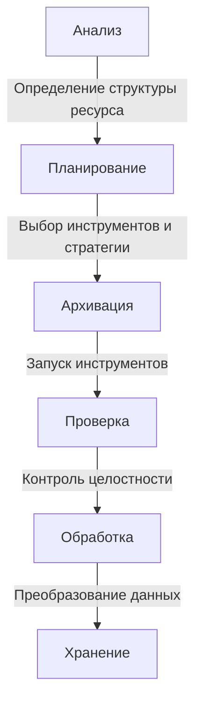

# Создание кастомных workflow для архивации

Руководство по созданию автоматизированных процессов архивации, объединяющих несколько инструментов Ruarxive и сторонние утилиты в единый процесс.

## Зачем нужны кастомные workflow

Стандартные инструменты решают отдельные задачи, но реальные проекты часто требуют:

*   **Комбинации инструментов**: несколько инструментов для одного ресурса (сайт, API, файлы, соцсети)
*   **Автоматизации**: запуск без ручного вмешательства
*   **Обработки данных**: проверка и преобразование между этапами
*   **Мониторинга**: отслеживание прогресса и ошибок
*   **Повторяемости**: возможность запускать процесс многократно

## Архитектура workflow

### Базовый workflow



## Используемые инструменты

| Инструмент | Что делает | Установка | Основные команды |
|:---|:---|:---|:---|
| [wget](/kb/guides/wget) | Сайт целиком в WARC | пакетный менеджер ОС | `wget --mirror ... --warc-file=ИМЯ` |
| [wparc](/kb/instruments/ruarxive-tools/wparc) | Данные сайта на WordPress через REST API | `pip install wparc` | `wparc ping`, `wparc dump`, `wparc getfiles` |
| [apibackuper](/kb/instruments/downloaded-data/apibackuper) | Выгрузка постраничных REST API | `pip install apibackuper` | `apibackuper estimate full`, `run full`, `export` |
| [filegetter](/kb/instruments/ruarxive-tools/filegetter) | Массовое скачивание файлов по списку | `pip install "filegetter[warc]"` | `filegetter run` |
| [tgarc](/kb/instruments/ruarxive-tools/tgarc) | Telegram-каналы в JSONL с медиа | `pip install git+https://github.com/ruarxive/tgarc.git` | `tgarc configure`, `tgarc save` |

> Команды сверены с `--help` версий wget 1.25.0, apibackuper 2.0.0, filegetter 1.1.0, tgarc 0.1.4, wparc 1.0.8 (октябрь 2026). Команды `wparc index` и `wparc warc` (экспорт выгрузки в WARC) есть в версии из [репозитория на GitHub](https://github.com/ruarxive/wparc), но отсутствуют в релизе 1.0.8 на PyPI.

## Примеры workflow

### Workflow 1: Комплексный веб-ресурс

Архивация сайта, у которого есть WordPress, отдельное API и каталог файлов. Пример условный: адрес API, структуру ответа и шаблон адресов файлов нужно заменить на реальные.

```bash
#!/bin/bash
# archive-complex-site.sh example.com
set -uo pipefail

DOMAIN="$1"
DATE=$(date +%Y-%m-%d)
OUT="$(pwd)/archive-$DOMAIN-$DATE"
mkdir -p "$OUT"/{web,wordpress,api,files,logs}

echo "=== Этап 1: сайт целиком в WARC ==="
( cd "$OUT/web" && wget --mirror --page-requisites --no-parent \
    --wait=1 --random-wait --delete-after \
    --warc-file="$DOMAIN-$DATE" --warc-cdx \
    "https://$DOMAIN/" ) > "$OUT/logs/wget.log" 2>&1
# wget возвращает ненулевой код и при отдельных ошибках 404 — проверьте журнал
echo "wget завершился с кодом $?"

echo "=== Этап 2: данные WordPress ==="
if wparc ping "$DOMAIN" > "$OUT/logs/wparc.log" 2>&1; then
  ( cd "$OUT/wordpress" && wparc dump "$DOMAIN" && wparc getfiles "$DOMAIN" ) \
    >> "$OUT/logs/wparc.log" 2>&1 \
    && echo "✓ WordPress выгружен" || echo "✗ Ошибка wparc, см. журнал"
else
  echo "— WordPress REST API недоступен, этап пропущен"
fi

echo "=== Этап 3: API ==="
API_PROJECT="$OUT/api/project"
mkdir -p "$API_PROJECT"
cat > "$API_PROJECT/apibackuper.yaml" <<EOF
settings:
  name: $DOMAIN-api

project:
  url: https://$DOMAIN/api/v1/items
  http_mode: GET
  iterate_by: page

params:
  page_number_param: page
  page_size_param: per_page
  page_size_limit: 100

data:
  data_key: items
  total_number_key: total

storage:
  storage_type: zip

rate_limit:
  enabled: true
  requests_per_second: 2
EOF

if apibackuper validate-config -p "$API_PROJECT" >> "$OUT/logs/api.log" 2>&1; then
  apibackuper estimate full -p "$API_PROJECT" >> "$OUT/logs/api.log" 2>&1
  apibackuper run full -p "$API_PROJECT" >> "$OUT/logs/api.log" 2>&1 \
    && apibackuper export "$OUT/api/items.jsonl" -p "$API_PROJECT" >> "$OUT/logs/api.log" 2>&1 \
    && echo "✓ API выгружено" || echo "✗ Ошибка apibackuper, см. журнал"
fi

echo "=== Этап 4: файлы по шаблону адресов ==="
FILES_PROJECT="$OUT/files"
seq 1 1000 > "$FILES_PROJECT/ids.txt"
cat > "$FILES_PROJECT/filegetter.cfg" <<EOF
[project]
name = $DOMAIN-files
source = ids.txt
source_type = list

[files]
fetch_mode = pattern
root_url = https://$DOMAIN/files/{}.pdf
keys = id
delay = 1
retries = 3

[storage]
file_storage_type = zip
write_warc = True
EOF
filegetter run -p "$FILES_PROJECT" > "$OUT/logs/filegetter.log" 2>&1 \
  && echo "✓ Файлы скачаны" || echo "✗ Ошибка filegetter, см. журнал"

echo "=== Этап 5: проверка и контрольные суммы ==="
find "$OUT" -type f \( -name '*.warc.gz' -o -name '*.zip' -o -name '*.jsonl' \) \
  -exec sha256sum {} \; > "$OUT/SHA256SUMS"
wc -l < "$OUT/SHA256SUMS" | xargs echo "Файлов с контрольными суммами:"

echo "=== Workflow завершён: $OUT ==="
```

Что получится:

- `web/` — WARC-файл сайта и CDX-индекс;
- `wordpress/<домен>/` — JSONL-файлы по маршрутам WordPress API и медиафайлы;
- `api/items.jsonl` — экспорт данных API (хранилище проекта — внутри `api/project/`);
- `files/storage/files.zip`, `files/storage/files.warc.gz` и отчёт `files/storage/processed.csv` с HTTP-статусом и SHA-256 каждого файла;
- `SHA256SUMS` — контрольные суммы итоговых файлов.

Перед запуском на реальном ресурсе проверьте конфигурации: `apibackuper detect` помогает подобрать параметры постраничной выдачи, а `filegetter run --dry-run` показывает, какие файлы будут скачаны.

### Workflow 2: Telegram-канал и связанный сайт

Перед первым запуском tgarc нужно один раз выполнить `tgarc configure` (ключи приложения с [my.telegram.org](https://my.telegram.org/apps), номер телефона и код подтверждения).

```python
#!/usr/bin/env python3
# archive-social-workflow.py

import json
import subprocess
from datetime import datetime
from pathlib import Path


class ArchiveWorkflow:
    def __init__(self, project_name, output_dir):
        self.project_name = project_name
        self.run_dir = Path(output_dir) / datetime.now().strftime("%Y-%m-%d_%H%M%S")
        self.run_dir.mkdir(parents=True, exist_ok=True)
        self.logs = []

    def log(self, message):
        line = f"[{datetime.now().isoformat(timespec='seconds')}] {message}"
        print(line)
        self.logs.append(line)

    def run(self, args, description, cwd=None):
        self.log(f"Запуск: {description}")
        result = subprocess.run(args, cwd=cwd, capture_output=True, text=True)
        if result.returncode == 0:
            self.log(f"✓ {description}")
        else:
            self.log(f"✗ {description}: код {result.returncode}\n{result.stderr[-2000:]}")
        return result.returncode

    def archive_telegram(self, channels):
        """Сохранение каналов через tgarc: <папка>/<канал>/messages.jsonl + медиа."""
        out = self.run_dir / "telegram"
        self.run(["tgarc", "save", *channels, "-o", str(out)], "Telegram-каналы")
        for channel_dir in sorted(p for p in out.glob("*") if p.is_dir()):
            messages = channel_dir / "messages.jsonl"
            if messages.exists():
                with messages.open(encoding="utf-8") as f:
                    count = sum(1 for _ in f)
                self.log(f"  {channel_dir.name}: {count} сообщений")

    def archive_website(self, url, name):
        """Сайт целиком в WARC через wget."""
        out = self.run_dir / "website"
        out.mkdir(exist_ok=True)
        self.run(
            ["wget", "--mirror", "--page-requisites", "--no-parent",
             "--wait=1", "--random-wait", "--delete-after",
             f"--warc-file={name}", "--warc-cdx", url],
            f"Сайт {url}",
            cwd=out,
        )

    def create_index(self):
        """Сводка по компонентам архива."""
        index = {"project": self.project_name, "date": datetime.now().isoformat(), "components": []}
        for component in sorted(p for p in self.run_dir.iterdir() if p.is_dir()):
            files = [f for f in component.rglob("*") if f.is_file()]
            index["components"].append({
                "name": component.name,
                "files": len(files),
                "size": sum(f.stat().st_size for f in files),
            })
        (self.run_dir / "index.json").write_text(
            json.dumps(index, indent=2, ensure_ascii=False), encoding="utf-8")
        self.log("✓ Индекс создан")

    def save_logs(self):
        (self.run_dir / "workflow.log").write_text("\n".join(self.logs), encoding="utf-8")


if __name__ == "__main__":
    wf = ArchiveWorkflow("social-media-project", "./archive-social")
    wf.archive_telegram(["channel_name"])
    wf.archive_website("https://example.com/", "example-com")
    wf.create_index()
    wf.save_logs()
```

Каждый запуск пишет результаты в новую папку с датой и временем. Это важно для tgarc: при повторной выгрузке файл `messages.jsonl` в той же папке перезаписывается.

### Workflow 3: Регулярная архивация по расписанию

Для регулярных задач проще всего использовать `cron`, а не держать постоянно запущенный скрипт.

**Telegram-каналы — только новые сообщения.** Режим `tgarc save --update` выгружает сообщения, появившиеся после предыдущего запуска (номер последнего сообщения tgarc хранит в своих настройках). Сохраняйте каждый запуск в отдельную папку:

```bash
#!/bin/bash
# tg-daily.sh
OUT="/data/telegram/$(date +%Y-%m-%d)"
tgarc save --update --no-video channel1 channel2 channel3 -o "$OUT" \
  >> /data/telegram/tgarc.log 2>&1
```

**API — новые и изменившиеся записи.** Для регулярной дозагрузки у apibackuper есть команда `update`. Она запрашивает у API только записи новее прошлого запуска, поэтому API должен уметь фильтровать по дате или по полю изменения. Пример для API с параметром `updated_after`:

```yaml
project:
  work_modes: full,update
  update_mode: by_timestamp

params:
  update_since_param: updated_after   # имя параметра фильтра в API

data:
  item_key: id
```

```bash
#!/bin/bash
# api-weekly.sh
apibackuper update -p /data/api/my-api >> /data/api/my-api.log 2>&1 \
  && apibackuper export "/data/api/my-api-$(date +%Y-%m-%d).jsonl" -p /data/api/my-api
```

Если API фильтрует по значению поля записи (например, по номеру версии), вместо `by_timestamp` укажите `update_mode: by_change_key`, поле `data.change_key` и параметр `params.change_key_param`. Каждый запуск `update` хранится отдельным поколением в `runs/<id>/`, а экспорт содержит все версии записей: повторы по `item_key` удаляйте после экспорта.

В apibackuper 2.0 режим `run incremental` — псевдоним `run continue`. Он не сравнивает записи, а догружает страницы, которых ещё нет в хранилище. Для продолжения прерванного запуска — `apibackuper run full --resume`. Подробнее — на странице [apibackuper](/kb/instruments/downloaded-data/apibackuper#обновление-update).

**Расписание (`crontab -e`):**

```cron
# Каждый день в 03:00 — новые сообщения Telegram-каналов
0 3 * * *  /opt/archive/tg-daily.sh

# Каждое воскресенье в 02:00 — новые записи API
0 2 * * 0  /opt/archive/api-weekly.sh
```

## Обработка ошибок

### Повтор при сбое

```python
import subprocess
import time
from functools import wraps


def retry(max_attempts=3, delay=5):
    def decorator(func):
        @wraps(func)
        def wrapper(*args, **kwargs):
            for attempt in range(1, max_attempts + 1):
                try:
                    return func(*args, **kwargs)
                except Exception as e:
                    if attempt == max_attempts:
                        raise
                    print(f"Попытка {attempt} не удалась: {e}. Повтор через {delay} сек...")
                    time.sleep(delay)
        return wrapper
    return decorator


@retry(max_attempts=3, delay=10)
def archive_page(url, warc_name):
    subprocess.run(
        ["wget", "--page-requisites", f"--warc-file={warc_name}", "--delete-after", url],
        check=True,
    )
```

При повторе используйте новое имя WARC-файла (например, с номером попытки), чтобы не перезаписать уже собранное.

### Проверка зависимостей

```bash
#!/bin/bash
# check-dependencies.sh

ERRORS=0
for cmd in wget apibackuper wparc tgarc filegetter jq sha256sum; do
  if command -v "$cmd" > /dev/null 2>&1; then
    echo "✓ $cmd установлен"
  else
    echo "✗ $cmd не установлен"
    ERRORS=$((ERRORS + 1))
  fi
done

if ! wget --help | grep -q -- '--warc-file'; then
  echo "✗ wget собран без поддержки WARC"
  ERRORS=$((ERRORS + 1))
fi

if [ "$ERRORS" -gt 0 ]; then
  echo "Обнаружено проблем: $ERRORS"
  exit 1
fi
echo "Все зависимости установлены"
```

На macOS вместо `sha256sum` используйте `shasum -a 256`.

## Мониторинг и логирование

### Структурированное логирование

```python
import logging
from logging.handlers import RotatingFileHandler


def setup_logging(log_file="workflow.log"):
    logger = logging.getLogger("archive_workflow")
    logger.setLevel(logging.INFO)

    file_handler = RotatingFileHandler(log_file, maxBytes=10 * 1024 * 1024, backupCount=5)
    file_handler.setFormatter(logging.Formatter("%(asctime)s - %(levelname)s - %(message)s"))

    console_handler = logging.StreamHandler()
    console_handler.setFormatter(logging.Formatter("%(levelname)s - %(message)s"))

    logger.addHandler(file_handler)
    logger.addHandler(console_handler)
    return logger


logger = setup_logging()
logger.info("Запуск workflow")
logger.error("Ошибка при архивации")
```

## Лучшие практики

1. **Идемпотентность**: повторный запуск не должен портить результаты прошлых запусков — пишите каждый запуск в новую папку.
2. **Логирование**: сохраняйте журналы всех инструментов рядом с данными.
3. **Проверки**: проверяйте результат каждого этапа (наличие файлов, контрольные суммы, `warcio check` для WARC).
4. **Обработка ошибок**: сбой одного этапа не должен останавливать остальные, но должен быть виден в журнале.
5. **Документация**: опишите workflow и его параметры в `README` рядом со скриптом.
6. **Тестирование**: запускайте на небольших объёмах (`filegetter run --limit`, `apibackuper estimate`) перед полным запуском.
7. **Правовые ограничения**: автоматизация не отменяет правил — см. [Правовые и этические вопросы](/kb/legal).

## Связанные материалы

- [Wget: сайт в WARC](/kb/guides/wget)
- [Архивация комплексных ресурсов](/kb/case-studies/multi-tool-archiving)
- [Все инструменты Ruarxive](/kb/instruments/ruarxive-tools)
- [apibackuper](/kb/instruments/downloaded-data/apibackuper)
- [WARC: от архива до публикации](/kb/guides/warc-workflow)
