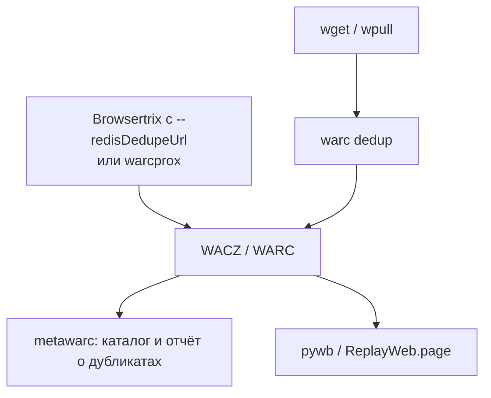

# WARC-дедупликация — устранение дубликатов

Дедупликация WARC — способ не хранить одно и то же содержимое много раз. Повторная копия ответа заменяется короткой записью `revisit`, которая ссылается на уже сохранённый оригинал. История захватов при этом сохраняется: видно, что страница была запрошена в такую-то дату и её содержимое совпало с прежним.

## Зачем нужна

| Сценарий | Без дедупликации | С дедупликацией |
|:---|:---|:---|
| Сайт пересобирается регулярно, страницы почти не меняются | Каждая копия хранится полностью | Полная копия при первом захвате + короткие `revisit` при последующих |
| Одинаковые ресурсы на многих страницах (логотипы, скрипты, шрифты) | Повторяются в каждом сборе | Хранятся один раз |
| Несколько сборов одного сайта подряд | Объём растёт пропорционально числу сборов | Растёт только на объём изменившегося содержимого |

Насколько уменьшится архив, зависит от того, как часто меняется содержимое. Оцените это на своих данных (см. раздел «Как оценить экономию»), а не по чужим цифрам.

## Как устроена revisit-запись

По [WARC 1.1](https://iipc.github.io/warc-specifications/specifications/warc-format/warc-1.1/#revisit):

- **Первая** встреченная копия остаётся обычной записью `response` с полным телом.
- **Последующие** копии с тем же содержимым записываются как `revisit` и ссылаются назад — на более раннюю запись. Поэтому `WARC-Refers-To-Date` всегда не позже собственной `WARC-Date` записи.
- В `revisit` обязателен `WARC-Profile`. Для совпадения по хешу тела — `http://netpreserve.org/warc/1.1/revisit/identical-payload-digest` (для WARC 1.0 — `.../warc/1.0/revisit/identical-payload-digest`). Второй профиль, `.../revisit/server-not-modified`, используется, когда сервер ответил `304 Not Modified`.
- Рекомендуются ссылки на оригинал: `WARC-Refers-To` (ID записи), `WARC-Refers-To-Target-URI` и `WARC-Refers-To-Date`. HTTP-заголовки ответа обычно тоже сохраняются, а тело — нет.

Пример: три захвата одной страницы с одинаковым содержимым после обработки `warc dedup` из warchaeology (вывод `warcio index`):

```
{"warc-type": "response", "warc-date": "2026-06-01T12:00:00Z", "warc-payload-digest": "sha1:XV2QDANQJHES5I2ETU6O75QESILTHIYI"}
{"warc-type": "revisit", "warc-date": "2026-07-01T12:00:00Z", "warc-refers-to-target-uri": "https://example.com/", "warc-refers-to-date": "2026-06-01T12:00:00Z", "warc-refers-to": "<urn:uuid:34020a97-761e-487c-9fd1-a63ae07b4f67>", "warc-profile": "http://netpreserve.org/warc/1.0/revisit/identical-payload-digest", "warc-payload-digest": "sha1:XV2QDANQJHES5I2ETU6O75QESILTHIYI"}
{"warc-type": "revisit", "warc-date": "2026-08-01T12:00:00Z", "warc-refers-to-target-uri": "https://example.com/", "warc-refers-to-date": "2026-06-01T12:00:00Z", "warc-refers-to": "<urn:uuid:34020a97-761e-487c-9fd1-a63ae07b4f67>", "warc-profile": "http://netpreserve.org/warc/1.0/revisit/identical-payload-digest", "warc-payload-digest": "sha1:XV2QDANQJHES5I2ETU6O75QESILTHIYI"}
```

Июньский захват остался полным, июльский и августовский стали `revisit` со ссылкой на июньский. pywb воспроизводит такие снимки, подставляя тело из оригинала: в CDX они видны с MIME-типом `warc/revisit`, а при открытии отдаётся полное содержимое. Такие же записи `warc/revisit` можно увидеть в CDX API Wayback Machine.

## Виды дедупликации

### По хешу содержимого (`WARC-Payload-Digest`)

Самый распространённый вариант. Если хеш тела ответа совпал с уже сохранённым, вместо полной записи пишется `revisit`.

**Плюсы:** точно — совпадает именно содержимое; соответствует стандарту WARC; история захватов сохраняется.

**Минусы:**

- Содержимое, которое меняется на каждом запросе (счётчики, токены, даты в HTML), не дедуплицируется.
- Для ссылок между файлами нужен общий индекс хешей, а при воспроизведении должны быть доступны все файлы, где лежат оригиналы.

Сравнивать можно только среди одного URL или между разными URL. Например, Browsertrix Crawler внутри одного обхода дедуплицирует одинаковое содержимое и под разными URL.

### Пропуск повторных URL

Повторный URL вообще не записывается. Так Browsertrix Crawler по умолчанию поступает внутри одного обхода, а pywb в режиме записи — при `dedup_policy: skip`. Это экономнее, но о повторном захвате в архиве не остаётся следа. Для сравнения версий страницы во времени это не подходит.

### Похожее, но не идентичное содержимое

Методы поиска почти-дубликатов (MinHash, SimHash и т. п.) применяют в исследовательских задачах, но стандартного способа записать «почти такую же» страницу как `revisit` нет: профиль `identical-payload-digest` требует точного совпадения.

## Инструменты

### При сборе (лучший вариант)

Дедуплицировать дешевле всего в момент записи, когда краулер ещё не записал дубликат на диск.

- **[Browsertrix Crawler](/kb/instruments/tools/browsertrix)** (с версии 1.12) — внутри одного обхода дедупликация включена автоматически. Для дедупликации между обходами задайте общий индекс в Redis-совместимой базе флагом `--redisDedupeUrl redis://host:port/db`; второй обход того же сайта запишет `revisit` вместо уже сохранённого содержимого. Подробности — в [документации](https://crawler.docs.browsertrix.com/user-guide/dedupe/).
- **[warcprox](/kb/instruments/tools/warcprox)** — дедупликация включена по умолчанию: хеши хранятся в SQLite-файле (`--dedup-db-file`, по умолчанию `./warcprox.sqlite`). Есть варианты с RethinkDB и с удалённым CDX-сервером (`--cdxserver-dedup`).
- **pywb в режиме записи** — ключ `dedup_policy` в блоке `recorder` файла `config.yaml`: `revisit` (писать revisit-записи), `skip` (пропускать дубликаты), `keep`; требуется Redis. Это относится только к записи через pywb, а не к воспроизведению.

```yaml
# config.yaml pywb — запись с дедупликацией
recorder:
  source_coll: live
  dedup_policy: revisit
  dedup_index_url: 'redis://localhost:6379/0/pywb:{coll}:cdxj'
```

### После сбора

- **[warchaeology](/kb/instruments/tools/warchaeology)** (Национальная библиотека Норвегии) — команда `warc dedup` переписывает WARC, заменяя повторы на `revisit`. Выходной каталог задаётся флагом `-w`; по умолчанию дедупликация выполняется, только если экономия на записи не меньше 2 КБ (`--min-size-gain`).

```bash
mkdir deduplicated
warc dedup -w deduplicated/ archive/*.warc.gz

# одна выходная запись на каждый входной файл
warc dedup -w deduplicated/ --one-to-one archive/*.warc.gz
```

- **[jwarc](https://github.com/iipc/jwarc)** (Java) — `java -jar jwarc.jar dedupe [options] файлы…`; флаг `--dry-run` только считает статистику, `--cache-size N` включает дедупликацию между разными URL, `--cdx-server URL` — сверку с внешним CDX-сервером.
- **[doppelganger](https://github.com/internetarchive/doppelganger)** (Internet Archive) — сервер дедупликации на Go и ScyllaDB, не зависящий от URL. По README проект в разработке (WIP).

> `warc dedup` проверен на warchaeology 5.0.0, воспроизведение revisit — на pywb 2.10.0 (октябрь 2026); параметры jwarc и doppelganger сверены с исходным кодом и README.

## Как оценить экономию

Прежде чем переписывать архивы, посчитайте дубликаты.

### metawarc

[metawarc](/kb/instruments/ruarxive-tools/metawarc) строит каталог коллекции и находит группы записей с одинаковым содержимым, включая объём, который можно освободить (`reclaimable_bytes`):

```bash
metawarc index 'archive/*.warc.gz' --dbfile collection.db
metawarc analyze hashes --dbfile collection.db
metawarc analyze duplicates --dbfile collection.db --output duplicates.csv --output-format csv
```

### SQL по индексу

Индекс из `warcio index` (JSON Lines) можно анализировать в DuckDB:

```bash
warcio index -f warc-type,warc-target-uri,warc-date,warc-payload-digest,length archive.warc.gz > archive.index.jsonl
```

```sql
-- Группы ответов с одинаковым содержимым
SELECT "warc-payload-digest" AS digest,
       COUNT(*)              AS copies,
       MIN("warc-date")      AS first_seen,
       MAX("warc-date")      AS last_seen
FROM read_json_auto('archive.index.jsonl')
WHERE "warc-type" = 'response'
GROUP BY digest
HAVING COUNT(*) > 1
ORDER BY copies DESC
LIMIT 20;
```

Подробнее о SQL по WARC — [DuckDB-WARC](/kb/instruments/tools/duckdb-warc).

## Особенности

### Оригиналы должны оставаться доступными

`revisit` без оригинала бесполезен: плеер не сможет показать содержимое. При дедупликации между файлами или между сборами храните и публикуйте всю цепочку файлов вместе, а индекс для replay стройте по всем файлам сразу.

### Что не уменьшается

Количество записей не уменьшается — каждая повторная копия остаётся в виде `revisit`. Уменьшается объём: тело ответа больше не хранится повторно.

## Когда использовать

✅ Подходит:

- **Периодические сборы** одних и тех же сайтов (ежедневно, еженедельно).
- **Большие коллекции**, где повторяются общие ресурсы.
- **Долгосрочное хранение**, где важен объём.

❌ Не подходит или почти бесполезно:

- **Разовый сбор** — дубликатов почти нет. Например, архив сайта «Эха Москвы» собран один раз, 3–4 марта 2022 года ([проект «Эхо Москвы»](/kb/projects/echomsk)), и дедупликация между захватами к нему неприменима.
- **Постоянно меняющийся контент** — хеши почти всегда различаются.
- **Если плеер или пайплайн не поддерживает `revisit`** — сначала проверьте воспроизведение на копии.

## Чего избегать

❌ **Удалять повторные записи целиком вместо `revisit`** — пропадает информация о том, что страница была захвачена в эту дату.
❌ **Ссылаться вперёд во времени** — оставлять полной последнюю копию, а ранние превращать в `revisit`. По стандарту `revisit` ссылается на более раннюю запись; инструменты и плееры рассчитывают именно на это.
❌ **Дедуплицировать по похожему URL** (например, удалять `/news/2`, если есть `/news/1`) — это разные страницы.
❌ **Разносить оригиналы и revisit по разным местам хранения** без общего индекса.

## Интеграция в pipeline



- Если собираете сами — включайте дедупликацию в краулере.
- Если получили готовые WARC — оцените дубликаты через metawarc, затем при необходимости перепишите файлы через `warc dedup`, сохранив исходники до проверки результата.

## Сравнение инструментов

| Инструмент | Когда работает | Алгоритм | Результат |
|:---|:---|:---|:---|
| **Browsertrix Crawler** | при сборе | хеш содержимого; пропуск повторных URL внутри обхода | `revisit` в WACZ |
| **warcprox** | при сборе | хеш содержимого (SQLite, RethinkDB или CDX-сервер) | `revisit` в WARC |
| **pywb (recorder)** | при записи через pywb | хеш содержимого + Redis | `revisit` или пропуск |
| **warchaeology `warc dedup`** | после сбора | хеш содержимого | новые WARC с `revisit` |
| **jwarc `dedupe`** | после сбора | хеш содержимого, опционально между URL | новые WARC с `revisit` |
| **metawarc** | анализ | хеш содержимого | отчёт, WARC не меняет |

## Ресурсы

- [WARC 1.1 — раздел revisit](https://iipc.github.io/warc-specifications/specifications/warc-format/warc-1.1/#revisit)
- [Browsertrix Crawler — Deduplication](https://crawler.docs.browsertrix.com/user-guide/dedupe/)
- [pywb — Dedup Options for Recording](https://pywb.readthedocs.io/en/latest/manual/configuring.html#dedup-options-for-recording)
- [warchaeology](https://github.com/NationalLibraryOfNorway/warchaeology)
- [jwarc](https://github.com/iipc/jwarc)
- [warcprox](https://github.com/internetarchive/warcprox)

## Связанные материалы

- [Warchaeology](/kb/instruments/tools/warchaeology) — набор утилит.
- [DuckDB-WARC](/kb/instruments/tools/duckdb-warc) — SQL по WARC.
- [Формат WARC](/kb/instruments/file-formats/warc)
- [pywb](/kb/instruments/replay/pywb) — воспроизведение revisit-записей.
- [WARC-файл: от сырого архива до публикации](/kb/guides/warc-workflow)
- [Обработка WARC — обзор](/kb/instruments/tools/warc-processing)
- [Работа с большими WARC](/kb/users/large-warc)
