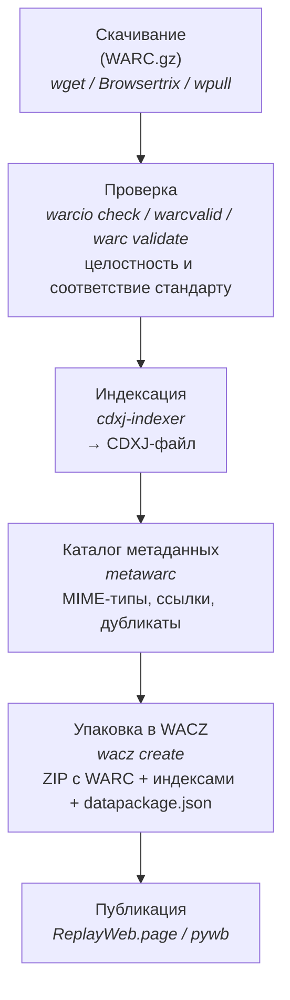

# WARC-файл: от сырого архива до публикации

> **Коротко:** WARC — это сырой контейнер с HTTP-ответами. Чтобы им могли пользоваться люди и исследователи, нужно: проверить целостность → построить индекс (CDXJ) → при необходимости собрать каталог метаданных → упаковать в WACZ → открыть в плеере.

Wget, Browsertrix, wpull, Heritrix и почти любой краулер сохраняют результат в формате [WARC](/kb/instruments/file-formats/warc). Но сам по себе WARC-файл — это просто последовательность HTTP-записей. Чтобы превратить его в полезный архив, нужно пройти несколько этапов обработки. Этот гайд описывает полный путь.

> Команды гайда проверены в октябре 2026 года на warcio 1.8.1, warctools 5.0.1, cdxj-indexer 1.5.0, wacz 0.6.0, pywb 2.10.0 и metawarc 2.0.3.

## Полный pipeline



## 1. Скачивание

Если вы ещё не скачали сайт, начните с одного из гайдов:

- [Wget](/kb/guides/wget) — статические сайты, без JavaScript
- [Browsertrix](/kb/instruments/tools/browsertrix) — современные сайты с JavaScript
- [wpull](/kb/instruments/tools/wpull) — если нужна WARC-совместимая замена wget
- [Как создать цифровой архив сайта](/kb/instruments/howto-collect/make-copy-website) — обзорная страница

Browsertrix Crawler сразу собирает WACZ. Результат пишется в каталог `/crawls` внутри контейнера, поэтому монтировать нужно именно его:

```bash
docker run -v "$PWD/crawls:/crawls/" -it webrecorder/browsertrix-crawler crawl \
  --url https://example.com/ --generateWACZ --text --collection example
# готовый файл: crawls/collections/example/example.wacz
```

:::tip Совет
При сохранении через Browsertrix сразу получается WACZ. С wget и wpull получается WARC — его упаковывают в WACZ командой `wacz create` (шаг 5).
:::

## 2. Проверка

Перед публикацией стоит убедиться, что WARC-файл не повреждён и соответствует стандарту.

### `warcio check` — дайджесты записей

```bash
pip install warcio
warcio check -v my-archive.warc.gz
```

Проверяет, что записи читаются и что `WARC-Block-Digest`/`WARC-Payload-Digest` совпадают с содержимым. Код возврата не равен нулю, если есть ошибки.

### `warcvalid` — из пакета warctools

```bash
pip install warctools
warcvalid my-archive.warc.gz
```

Отдельного пакета `warcvalid` на PyPI нет — утилита входит в [warctools](https://github.com/internetarchive/warctools).

### `warc validate` и `jwarc validate`

Более строгую проверку на соответствие стандарту делают:

- [warchaeology](/kb/instruments/tools/warchaeology) — `warc validate my-archive.warc.gz` (Go-бинарник из [релизов](https://github.com/NationalLibraryOfNorway/warchaeology/releases));
- [jwarc](https://github.com/iipc/jwarc) — `java -jar jwarc.jar validate my-archive.warc.gz` (Java).

### Контрольные суммы

Для долгосрочного хранения фиксируйте SHA-256 WARC-файла:

```bash
sha256sum my-archive.warc.gz > my-archive.warc.gz.sha256
```

Храните файл `.sha256` вместе с архивом — так можно обнаружить повреждение при копировании.

## 3. Индексация (CDXJ)

Сырой WARC — это «лента» HTTP-записей. Чтобы быстро находить снимки по URL и дате, нужен индекс в формате [CDXJ](https://specs.webrecorder.net/cdxj/0.1.0/): строки вида `SURT TIMESTAMP {json}` со ссылкой на смещение записи в WARC. Это индекс по адресам, а не по словам: для поиска по тексту страниц нужен полнотекстовый движок (см. раздел «Публикация»).

```bash
pip install cdxj-indexer
cdxj-indexer --sort my-archive.warc.gz > my-archive.cdxj
```

Пример строки:

```
com,example)/about 20260601120005 {"url": "https://example.com/about", "mime": "text/html", "status": "200", "digest": "sha1:O6PWCPWYRWRLFS3O6BAHQ3FGDLPKDOFV", "length": "424", "offset": "676", "filename": "my-archive.warc.gz"}
```

Отдельно строить CDXJ нужно, если вы публикуете архив через pywb с собственной структурой каталогов. `wacz create` и `wb-manager add` строят индекс сами. Подробнее о формате — [CDX/CDXJ](/kb/instruments/file-formats/cdx).

## 4. Каталог метаданных (metawarc)

Чтобы понять, что лежит в коллекции (какие типы файлов, сколько ссылок, есть ли дубликаты), удобно построить каталог. В Ruarxive для этого есть [metawarc](/kb/instruments/ruarxive-tools/metawarc): он индексирует WARC в базу DuckDB и не меняет сами WARC-файлы.

```bash
pip install metawarc

# Каталог записей
metawarc index 'archives/**/*.warc*' --dbfile collection.db

# Статистика по MIME-типам
metawarc stats --dbfile collection.db --mode mimes

# Извлечь ссылки и построить отчёт по ссылочному графу
metawarc index-content --dbfile collection.db --type links
metawarc analyze links --dbfile collection.db --output links.csv --output-format csv

# Экспорт CDXJ-индекса из каталога
metawarc export-cdxj --dbfile collection.db -o collection.cdxj
```

Полный список команд — в [README metawarc](https://github.com/ruarxive/metawarc).

## 5. Упаковка в WACZ

[WACZ](https://specs.webrecorder.net/wacz/1.1.1/) — ZIP-пакет с заданной структурой:

- `archive/` — один или несколько WARC-файлов;
- `indexes/` — индекс CDXJ (`index.cdx.gz`) и вспомогательный `index.idx`;
- `pages/pages.jsonl` — список страниц;
- `datapackage.json` — описание пакета и SHA-256 каждого файла;
- `datapackage-digest.json` — хеш самого `datapackage.json`.

WACZ — основной формат для [ReplayWeb.page](https://replayweb.page/).

### Создание WACZ с помощью `wacz`

Собирать WACZ вручную через `zip` не нужно: спецификация требует, в частности, хранить WARC и индексы без сжатия ZIP, плюс нужны правильные хеши и список страниц. Утилита [py-wacz](https://github.com/webrecorder/py-wacz) делает всё сама:

```bash
pip install wacz

wacz create -o my-archive.wacz \
  --detect-pages \
  --title "Архив сайта example.com" \
  --desc "Архив сделан перед запланированным отключением сайта" \
  my-archive.warc.gz

# Проверка результата
wacz validate -f my-archive.wacz
```

На вход `wacz create` принимает WARC-файлы (не каталоги и не `.cdxj`). Полезные флаги: `--detect-pages` — найти страницы автоматически, `-p pages.jsonl` — свой список страниц, `--text` (вместе с `--detect-pages`) — извлечь текст для полнотекстового поиска в ReplayWeb.page.

## 6. Публикация

WACZ — самодостаточный пакет. Его можно открыть в плеере или выложить в интернет.

### Локальный просмотр (без сервера)

Самый простой способ — открыть WACZ в [ReplayWeb.page](https://replayweb.page/): **Choose File…** → **Load**.

### Собственный сервер на `pywb`

[pywb](/kb/instruments/replay/pywb) — серверный плеер, который хостит коллекции и даёт к ним доступ по постоянным URL.

```bash
pip install pywb

# Создать коллекцию
wb-manager init my-archive

# Добавить WACZ (распаковывает WARC и индексы в коллекцию)
wb-manager add --unpack-wacz my-archive /path/to/my-archive.wacz
# или добавить WARC напрямую
wb-manager add my-archive /path/to/my-archive.warc.gz

# Запуск (по умолчанию порт 8080)
wayback
```

После запуска архив доступен по адресу `http://localhost:8080/my-archive/2026/https://example.com/`.

### Хостинг статического WACZ

Если у вас есть статическое хранилище (S3-совместимое объектное хранилище, CDN), WACZ можно хостить как обычный файл и открывать в ReplayWeb.page по URL. Это дешевле, чем держать pywb, но нет CDX API и Memento.

#### Минимальный сценарий

1. Загрузите WACZ в объектное хранилище (S3, R2, Selectel Cloud Storage и т. п.).
2. Сделайте файл публично доступным и включите CORS (см. ниже).
3. Поделитесь ссылкой:

```
https://replayweb.page/?source=https://archive.example.org/data/my-archive.wacz
```

ReplayWeb.page не скачивает WACZ целиком, а запрашивает нужные части файла HTTP Range-запросами — поэтому сервер должен их поддерживать (объектные хранилища поддерживают).

#### Настройка CORS для S3 / R2

Браузер делает кросс-доменный запрос к хранилищу, поэтому нужны CORS-заголовки. Для AWS S3:

```json
[
  {
    "AllowedHeaders": ["*"],
    "AllowedMethods": ["GET", "HEAD"],
    "AllowedOrigins": ["https://replayweb.page"],
    "ExposeHeaders": ["Content-Range", "Content-Length"],
    "MaxAgeSeconds": 3000
  }
]
```

Для Cloudflare R2 в настройках бакета → CORS Policy:

```json
[
  {
    "AllowedOrigins": ["https://replayweb.page"],
    "AllowedMethods": ["GET", "HEAD"],
    "AllowedHeaders": ["Range"],
    "ExposeHeaders": ["Content-Range", "Content-Length"]
  }
]
```

Если плеер встроен на ваш собственный сайт (`<replay-web-page>`), в `AllowedOrigins` укажите домен этого сайта. Подробнее — [CORS Settings](https://replayweb.page/docs/embedding/cors-settings/) в документации ReplayWeb.page.

#### CDN

Перед хранилищем можно поставить CDN, чтобы ускорить раздачу большого WACZ. Проверьте, что CDN пропускает заголовок `Range` (ответы `206 Partial Content`) и CORS-заголовки.

#### Ограничения хостингов

- В S3-совместимых хранилищах размер одного объекта обычно ограничен примерно 5 ТБ — уточняйте в документации провайдера.
- GitHub Pages и обычные репозитории GitHub не подходят для больших файлов: файлы больше 100 МБ GitHub не принимает.
- Цены на хранение и трафик меняются — сверяйтесь с тарифами провайдеров.

#### Если архив слишком большой для одного файла

Не режьте WACZ командой `split`: WACZ — это ZIP-архив, и его куски не открываются. Разделите исходный WARC по границам записей (скрипт — в статье [Работа с большими WARC-файлами](/kb/users/large-warc)) и упакуйте каждую часть в отдельный WACZ через `wacz create`. Другой вариант — публиковать WARC через pywb.

#### Сравнение pywb и статического WACZ

| Сценарий | Свой pywb | Статический WACZ |
|:---|:---|:---|
| Инфраструктура | Сервер + администрирование | Только хранилище, без своего сервера |
| Поиск | По URL (CDX API) | По URL и страницам; полнотекстовый — если в WACZ есть текст |
| Memento и CDX API | Да | Нет |
| Большие архивы | Работает с WARC на сервере | Нужен WACZ с поддержкой Range-запросов |
| Логи и аудит | Полные | Логи доступа хранилища или CDN |

Для полнотекстового поиска по большой коллекции нужен отдельный движок, например [SolrWayback](/kb/instruments/tools/solrwayback).

## Чек-лист готовности к публикации

Прежде чем отдавать архив пользователям, проверьте:

- [ ] **WARC прошёл проверку** (`warcio check`, `warcvalid` или `warc validate`)
- [ ] **SHA-256 зафиксирован** и сохранён отдельно
- [ ] **Индекс построен** (внутри WACZ или CDXJ для pywb)
- [ ] **Метаданные коллекции заполнены** (название, описание, дата, источник)
- [ ] **WACZ упакован** через `wacz create` и проходит `wacz validate`
- [ ] **Архив проверен в плеере**: открыть 5–10 случайных страниц, проверить CSS, JS, изображения
- [ ] **WARC-файл и метаданные продублированы** в 2+ независимых хранилищах
- [ ] **Юридические вопросы проверены**: процедура снятия архива по запросу описана в [правовом разделе](/kb/legal/copyright)
- [ ] **Запись в каталоге** Ruarxive создана через [форму](https://airtable.com/shriiNZvNhcgaStm6) или обновление Airtable

## Хранение и долгосрочная сохранность

WARC — международный стандарт (ISO 28500), рассчитанный на долгое хранение. Но за это время:

- **Носители деградируют**: делайте 3 копии в разных местах (правило 3-2-1) и периодически сверяйте SHA-256.
- **Программы устаревают**: периодически проверяйте, что ваши `.warc.gz` и `.wacz` открываются актуальными инструментами.
- **Метаданные теряются**: храните `datapackage.json` и `.sha256` вместе с архивом, а не отдельно.
- **Индексы можно перестроить**: CDXJ — открытый текстовый формат (`SURT TIMESTAMP {json}`), и его всегда можно заново построить из WARC. Поэтому главное — сохранить сами WARC-файлы.

Подробнее о принципах цифрового сохранения — в [глоссарии](/kb/glossary) и [правовом разделе](/kb/legal).

## Связанные материалы

- [WARC — формат файла](/kb/instruments/file-formats/warc) — структура и спецификации
- [WACZ — упакованный архив](/kb/instruments/file-formats/wacz) — для плееров
- [CDX/CDXJ — индексы](/kb/instruments/file-formats/cdx) — для поиска по архиву
- [metawarc](/kb/instruments/ruarxive-tools/metawarc) — инструмент Ruarxive
- [Обработка WARC — библиотеки](/kb/instruments/tools/warc-processing) — Python, Java, Node.js, Rust
- [ReplayWeb.page и другие плееры](/kb/instruments/replay) — как открыть и хостить
- [Как открыть WARC обычному пользователю](/kb/users/open-warc) — инструкция для исследователей
- [Как создать архив сайта](/kb/instruments/howto-collect/make-copy-website) — откуда берётся WARC
- [Кастомные workflow](/kb/guides/custom-workflows) — автоматизация всех шагов pipeline
- [Кейс: wparc → metawarc → индексируемый архив](/kb/case-studies/wparc-to-metawarc-pipeline) — практический пример
