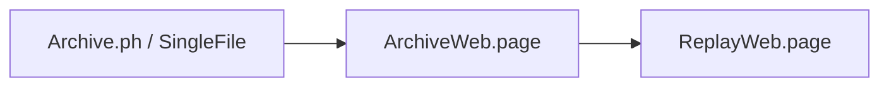
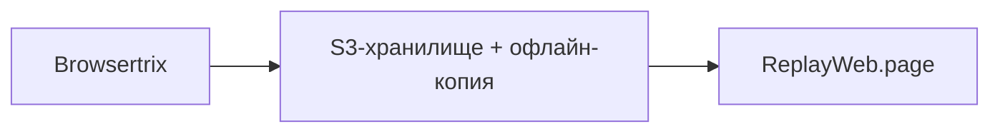
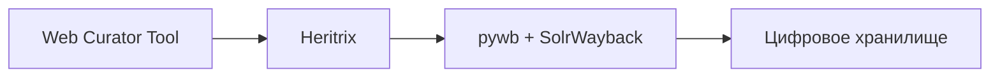
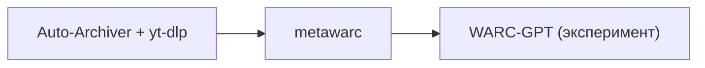
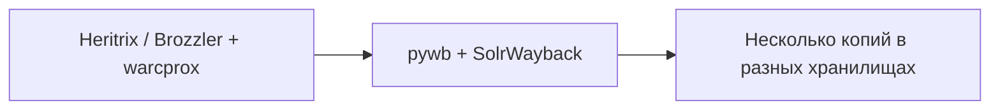
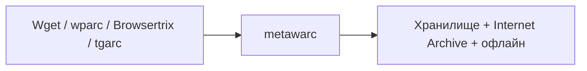

# Ландшафтная карта веб-архивации 2026

Состояние области на октябрь 2026 года. Ниже — попытка дать единую картину: какие инструменты существуют, кто их разрабатывает, что активно развивается, а что уходит в историю. Материал помогает выбрать инструмент под задачу и не тратить время на заброшенные проекты. Статусы проверены по репозиториям в октябре 2026 года.

> **Принцип:** один инструмент хорошо решает одну задачу. Хороший архивный конвейер — это **композиция** из нескольких инструментов.

## Четыре опоры архивации

Любая архивная система делает четыре вещи:

```mermaid
flowchart LR
    subgraph Capture["CAPTURE · сбор"]
        direction TB
        C1["Browsertrix"]
        C2["wget · Heritrix"]
        C3["wparc ⭐"]
        C4["yt-dlp"]
    end
    subgraph Storage["STORAGE · хранение"]
        direction TB
        S1["WARC / WACZ"]
        S2["S3-совместимые хранилища"]
        S3["Локальные и офлайн-копии"]
        S4["Internet Archive (items)"]
    end
    subgraph Access["ACCESS · доступ"]
        direction TB
        A1["ReplayWeb.page"]
        A2["pywb"]
        A3["Wayback Machine"]
        A4["Memento"]
    end
    subgraph Analysis["ANALYSIS · анализ"]
        direction TB
        N1["SolrWayback"]
        N2["metawarc ⭐"]
        N3["WARC-GPT"]
        N4["DuckDB-WARC"]
    end
    Capture --> Storage --> Access --> Analysis
```

Звёздочкой (⭐) отмечены собственные инструменты Ruarxive, остальное — сторонние проекты.

## 1. CAPTURE — сбор контента

### Браузерные кроулеры (полная поддержка JavaScript)

| Инструмент | Язык | Установка | Особенности | Статус |
|:---|:---|:---|:---|:---|
| [Browsertrix](/kb/instruments/tools/browsertrix) | Node.js + Chromium | Docker / облако / self-hosted | WACZ, поведения на странице (autoscroll, autoplay) | **Активен** |
| [Brozzler](/kb/instruments/tools/brozzler) | Python + Chromium | pip | Распределённый обход, состояние в RethinkDB, запись через warcprox | **Активен** |
| [Squidwarc](/kb/instruments/tools/squidwarc) | Node.js + Chrome | из исходников (npm-пакета нет) | Скриптуемый обход по JSON-конфигу | Не развивается с 2020 |
| [Warcworker](/kb/instruments/tools/warcworker) | Python + Squidwarc | Docker Compose | Очередь (RabbitMQ) и веб-интерфейс для отдельных URL | В архиве |
| [Crocoite](/kb/instruments/tools/crocoite) | Python + Chrome | pip | Скриншоты + DOM + WARC | Репозиторий архивирован в 2021 |
| [WAIL](/kb/instruments/tools/wail) | Python | GUI | Heritrix + OpenWayback «в один клик» | Для новых коллекций не рекомендуется |

### HTTP-кроулеры (без JavaScript)

| Инструмент | Язык | Формат | Статус |
|:---|:---|:---|:---|
| [Wget](/kb/instruments/tools/wget) | C | Файлы + WARC (1.14+) | **Активен** |
| [Heritrix](/kb/instruments/tools/heritrix) | Java | WARC | **Активен** |
| [grab-site](/kb/instruments/tools/grab-site) | Python (форк Wpull) | WARC | Поддерживается (изменения в 2025) |
| [Wpull](/kb/instruments/tools/wpull) | Python | Файлы + WARC | Последний релиз 2016 |
| [HTTrack](/kb/instruments/tools/httrack) | C | Зеркало | Активен |

### Специализированные загрузчики

| Инструмент | Для чего | Статус |
|:---|:---|:---|
| [yt-dlp](/kb/instruments/tools/yt-dlp) | Видео (более 1700 сайтов) | **Активен** |
| [gallery-dl](/kb/instruments/tools/gallery-dl) | Изображения | **Активен** |
| [tdl](/kb/instruments/tools/tdl) | Telegram | Активен |
| ⭐ [tgarc](/kb/instruments/ruarxive-tools/tgarc) | Telegram с метаданными | Не развивается с 2023 |
| ⭐ [wparc](/kb/instruments/ruarxive-tools/wparc) | WordPress через REST API | Активен |
| ⭐ [ydiskarc](/kb/instruments/ruarxive-tools/ydiskarc) | Яндекс Диск | Активен |
| ⭐ [filegetter](/kb/instruments/ruarxive-tools/filegetter) | Массовое скачивание файлов | Активен |
| [WikiTeam (wikiteam3)](/kb/instruments/tools/wikiteam) | Вики на MediaWiki | Активен |
| [Auto-Archiver (Bellingcat)](/kb/instruments/tools/auto-archiver) | Конвейер для OSINT | Активен |
| [twarc](/kb/instruments/social-media/twarc) | X/Twitter, JSON (`twarc2` для API v2) | Работает только с платным доступом к X API |
| [fbarc](/kb/instruments/social-media/fbarc) | Facebook | В архиве с 2018 |
| [Social Feed Manager](https://github.com/gwu-libraries/sfm-ui) | Несколько платформ | Не развивается (последние изменения — 2024) |

### Моментальное сохранение

| Инструмент | Для чего | Статус |
|:---|:---|:---|
| [Archive.ph](/kb/instruments/tools/archive-ph) | URL → снимок | Работает, но не годится как доказательство: оператор менял снимки (2026) |
| [SavePageNow](/kb/instruments/tools/wayback-api) | URL → снимок в Wayback Machine | Работает |
| [SingleFile](/kb/instruments/tools/singlefile) | Страница → один HTML (расширение + CLI) | **Активен** |
| [ArchiveWeb.page](https://archiveweb.page/) | Запись WARC/WACZ из браузера | Активен |
| [WebScrapBook](/kb/instruments/tools/webscrapbook) | Коллекция в браузере (Folder, HTZ, MAFF, Single HTML; без WARC) | Активен |
| [monolith](/kb/instruments/tools/monolith) | Страница → один HTML, CLI на Rust | Активен |
| [Obelisk](/kb/instruments/tools/obelisk) | Страница → один HTML, Go-библиотека и CLI | Развивается медленно |

## 2. STORAGE — хранение

### Форматы

| Формат | Назначение | Инструменты | Статус |
|:---|:---|:---|:---|
| [WARC](/kb/instruments/file-formats/warc) | Стандарт ISO 28500 (WARC 1.1) | Многие | **Стандарт** |
| [WACZ](/kb/instruments/file-formats/wacz) | ZIP + WARC + CDXJ + метаданные | Browsertrix, ArchiveWeb.page, ReplayWeb.page | Спецификация Webrecorder |
| ARC | Предшественник WARC | warctools, JWAT, warchaeology (`warc convert arc`) | Устаревший |
| [CDX/CDXJ](/kb/instruments/file-formats/cdx) | Индекс | pywb, cdxj-indexer | **Стандарт де-факто** |
| [ZIM](https://wiki.openzim.org/) | Офлайн-чтение через Kiwix | warc2zim, zimit | Формат openZIM |
| [BagIt](https://www.rfc-editor.org/rfc/rfc8493) | Упаковка для передачи | bagit-python | **Стандарт (RFC 8493)** |
| [PREMIS](/kb/instruments/file-formats/premis) | Метаданные сохранности | Системы цифрового хранения | **Стандарт** |
| [METS](/kb/instruments/file-formats/mets) | Структурные метаданные | Системы цифровых библиотек | Нишевый |
| [IIIF](/kb/instruments/file-formats/iiif) | Изображения высокого разрешения | Mirador, Cantaloupe | Нишевый |
| [PDF/A](/kb/instruments/file-formats/pdfa) | Долгосрочное хранение PDF | veraPDF | **Стандарт** |
| [SIARD](/kb/instruments/file-formats/siard) | Базы данных | DBPTK | Нишевый |
| [MBOX](/kb/instruments/file-formats/mbox) | Почтовые архивы | Thunderbird | **Стандарт де-факто** |
| [JP2](/kb/instruments/file-formats/jp2) | Изображения высокого разрешения | Kakadu, OpenJPEG | Нишевый |

### Хранилища

| Решение | Когда использовать |
|:---|:---|
| Локальный диск и офлайн-носители | Личный архив, резервная копия |
| S3-совместимые облака (AWS S3, Cloudflare R2, Backblaze B2 и др.) | Горячие и публичные копии |
| Российские облака (Selectel, Yandex Cloud и др.) | Хранение в РФ |
| Internet Archive (items) | Дополнительная публичная копия для некоммерческих проектов |

Цены облачных хранилищ меняются: сверяйтесь с актуальными тарифами провайдера (учитывайте и стоимость исходящего трафика).

### Правило 3-2-1

Любой важный архив должен иметь:

- **3 копии** данных;
- **2 разных типа носителей** (например, диск и облако);
- **1 копию в другом месте** (офлайн-бэкап или удалённый регион).

## 3. ACCESS — доступ

### Воспроизведение

| Инструмент | Тип | Когда | Статус |
|:---|:---|:---|:---|
| [ReplayWeb.page](/kb/instruments/replay/replayweb-page) | В браузере | Открыть WARC/WACZ без сервера | **Активен** |
| [pywb](/kb/instruments/replay/pywb) | Серверный | Публичный архив | **Активен** |
| [OpenWayback](/kb/instruments/replay/openwayback) | Серверный (Java) | Существующие установки; IIPC рекомендует переход на pywb | Последний релиз 2019 |
| [IPWB](/kb/instruments/replay/ipwb) | Распределённый (IPFS) | P2P-доступ | Экспериментальный |
| [warc2html](/kb/instruments/replay/warc2html) | Конвертер | Статическая публикация | Нишевый |
| [Memento](/kb/instruments/replay/memento) | Протокол RFC 7089 | Универсальный доступ к версиям | **Стандарт** |
| [Wayback Machine](https://web.archive.org/) | Публичный сервис | Глобальный доступ | Работает |

### Поиск по архивам

| Инструмент | Когда | Статус |
|:---|:---|:---|
| [SolrWayback](/kb/instruments/tools/solrwayback) | Полнотекстовый поиск и аналитика по своим WARC | **Активен** (5.5.0, сентябрь 2026) |
| [Shine](/kb/instruments/tools/shine) | Прототип исследовательского интерфейса UK Web Archive | В архиве с 2020 |
| [ArchiveSpark](https://github.com/helgeho/ArchiveSpark) | Обработка на Spark-кластере | Нишевый |
| [Warclight](https://github.com/archivesunleashed/warclight) | Фронтенд на Blacklight | В архиве с 2023 |

### Постоянные ссылки и поиск снимков

| Сервис | Когда | Статус |
|:---|:---|:---|
| [Perma.cc](/kb/similar/perma-cc) | Научное и юридическое цитирование | Работает |
| [Wayback Machine (SavePageNow)](/kb/instruments/tools/wayback-api) | Разовое сохранение | Работает |
| [Archive.ph](/kb/instruments/tools/archive-ph) | Моментальное сохранение | Работает; исключён из Википедии в 2026 году, только дополнительная копия |
| [PastPage](/kb/instruments/tools/pastpage) | Поиск снимка сразу в нескольких архивах (расширение браузера) | Активен (с 2026) |

## 4. ANALYSIS — анализ

### Обработка и обогащение

| Инструмент | Что делает | Статус |
|:---|:---|:---|
| ⭐ [metawarc](/kb/instruments/ruarxive-tools/metawarc) | Каталог и метаданные WARC-коллекций | **Активен** (2.0 — август 2026) |
| ⭐ [metawarc MCP](/kb/instruments/ruarxive-tools/metawarc-mcp) | MCP-сервер для LLM-агентов в составе metawarc | Развивается |
| [Обработка WARC](/kb/instruments/tools/warc-processing) | Библиотеки warcio, FastWARC, jwarc, gowarc и др. | **Активны** |
| [Warchaeology](/kb/instruments/tools/warchaeology) | Просмотр, валидация, дедупликация (Go) | **Активен** (5.0.0, март 2026) |
| [warcbench](https://github.com/harvard-lil/warcbench) | Исследование и преобразование WARC (Harvard LIL) | Развивается |
| [DuckDB-WARC](/kb/instruments/tools/duckdb-warc) | SQL-запросы к WARC (Harvard LIL) | Развивается |

### Защита и контроль качества

| Инструмент | Что делает | Статус |
|:---|:---|:---|
| [WARC-Safe](/kb/instruments/tools/warc-safe) | Проверка на вирусы (ClamAV) и NSFW, Национальная библиотека Люксембурга | Активен |
| `jwarc validate`, `warc validate`, `warcvalid` (warctools), JWAT-Tools `test` | Валидация WARC | Активны / стабильны |

### ИИ и RAG

| Инструмент | Что делает | Статус |
|:---|:---|:---|
| [WARC-GPT](/kb/instruments/tools/warc-gpt) | RAG по коллекции WARC (Harvard LIL) | Экспериментальный, малоактивен с 2025 |
| ⭐ [metawarc MCP](/kb/instruments/ruarxive-tools/metawarc-mcp) | Доступ LLM-агентов к каталогу коллекции | Развивается |
| [WARC-Bench](https://sanjari-orb.github.io/warc-bench/) | Бенчмарк ИИ-агентов на архивных копиях сайтов (ICLR 2026) | Исследовательский проект |

### Анализ графа ссылок

| Инструмент | Что делает | Статус |
|:---|:---|:---|
| [Hyphe](/kb/instruments/tools/hyphe) | Кроулер для корпусов с веб-интерфейсом | Активен |
| [WebGraph](https://github.com/vigna/webgraph) | Сжатое представление больших графов | Нишевый |
| [Gephi](https://gephi.org/) | Визуализация графов | Активен |

## Что ушло или уходит в архив

| Инструмент | Чем заменить | Примечание |
|:---|:---|:---|
| Conifer (Rhizome) | [ArchiveWeb.page](https://archiveweb.page/), [Browsertrix](/kb/instruments/tools/browsertrix) | С мая 2026 года только чтение, новые коллекции не создаются; переход в архивный режим перенесён с июня на конец 2026 года |
| [Shine](/kb/instruments/tools/shine) | [SolrWayback](/kb/instruments/tools/solrwayback) | Репозиторий в архиве с 2020 |
| [Squidwarc](/kb/instruments/tools/squidwarc), [Warcworker](/kb/instruments/tools/warcworker) | Browsertrix | Не развиваются / в архиве |
| Crocoite | Browsertrix | Репозиторий архивирован в 2021 году |
| [fbarc](/kb/instruments/social-media/fbarc) | — (API Facebook закрыт для такого сбора) | В архиве с 2018 |
| OpenWayback | [pywb](/kb/instruments/replay/pywb) | Последний релиз 2019 |
| Webrecorder Player | ReplayWeb.page (в браузере или настольное приложение) | Репозиторий в архиве |
| Adobe Flash | Эмулятор [Ruffle](https://ruffle.rs/) для просмотра сохранённых SWF | Поддержка браузерами прекращена в конце 2020 года |

ArchiveTeam Warrior не устарел: это действующий клиент распределённых проектов ArchiveTeam, который распространяется в том числе как Docker-образ ([warrior-dockerfile](https://github.com/ArchiveTeam/warrior-dockerfile)).

## Инициативы и сообщества

| Организация | Что делает |
|:---|:---|
| [IIPC](https://netpreserve.org/) | Стандарты (WARC), конференции, обучение, jwarc |
| [Webrecorder](https://webrecorder.net/) | Browsertrix, ReplayWeb.page, ArchiveWeb.page, pywb, спецификация WACZ |
| [Internet Archive](https://archive.org/) | Wayback Machine, Heritrix, Brozzler, warcprox |
| [Bellingcat](https://www.bellingcat.com/) | OSINT-инструменты, Auto-Archiver |
| [ArchiveTeam](https://wiki.archiveteam.org/) | Экстренные волонтёрские архивы, WikiTeam, grab-site |
| [Harvard Library Innovation Lab](https://lil.law.harvard.edu/) | Perma.cc, Scoop, WARC-GPT, warcbench, DuckDB-WARC |
| [Королевская библиотека Дании](https://www.kb.dk/en) | SolrWayback, NetarchiveSuite |
| Национальная библиотека Норвегии | Warchaeology, gowarc |
| Национальная библиотека Люксембурга | WARC-Safe |
| [Common Crawl Foundation](https://commoncrawl.org/) | Открытые веб-краулы, [cc-pyspark](https://github.com/commoncrawl/cc-pyspark) |
| [Rhizome](https://rhizome.org/) | Сохранение цифрового искусства; сервис Conifer с мая 2026 года работает только на чтение |
| ⭐ [Ruarxive](https://ruarxive.org/) | Архивация исчезающих российских сайтов и цифровых ресурсов (проект АНО «Инфокультура») |

## Что появилось в 2024–2026

- **Подпись WACZ** — [спецификация WACZ Signing and Verification](https://specs.webrecorder.net/wacz-auth/latest/); подписывает, например, Scoop от Harvard LIL.
- **WARC-GPT** — RAG по коллекциям WARC (Harvard LIL, анонс в феврале 2024).
- **WARC-Safe** — проверка на вирусы и NSFW (Национальная библиотека Люксембурга, репозиторий с мая 2024; совместимость с warc-indexer — с июня 2026).
- **DuckDB-WARC** — SQL к WARC (Harvard LIL, репозиторий с декабря 2025).
- **WARC-Bench** — бенчмарк ИИ-агентов на архивных копиях сайтов (2025–2026).
- **Warchaeology 5.0** — новая версия утилиты `warc` (Национальная библиотека Норвегии, март 2026; проект существует с 2021 года).
- **PastPage** — расширение для поиска снимков в нескольких архивах (2026).
- ⭐ **metawarc 2.0** — август 2026.

## Что ушло в 2024–2026

- **Conifer** (Rhizome) — с мая 2026 года работает только на чтение, новые захваты не принимаются.
- **Pocket** (Mozilla, июль 2025) и **Omnivore** (ноябрь 2024) — закрыты; для миграции закладок подходит [wallabag](/kb/instruments/tools/wallabag).
- **Hitomi Downloader** — репозиторий заблокирован на GitHub по DMCA с 30.03.2026 (см. [GUI-оболочки](/kb/instruments/tools/youtube-dl-gui)).
- **Доверие к archive.today** — в феврале 2026 года английская Википедия признала сервис ненадёжным: его CAPTCHA-страница участвовала в DDoS-атаке, а оператор менял сохранённые снимки. Сервис работает, но годится только как дополнительная копия (см. [Archive.ph](/kb/instruments/tools/archive-ph)).
- **Memento Time Travel** (`timetravel.mementoweb.org`) — публичный агрегатор не отвечает в 2026 году (см. [Memento](/kb/instruments/replay/memento)).

## Как выбрать инструмент

### Для новичка (1–3 сайта)

### Для активиста (один сайт, регулярный сбор)

### Для университетской библиотеки

### Для OSINT-журналиста

### Для национального архива

### Для Ruarxive

## См. также

- [Программы и утилиты — обзор](/kb/instruments/tools)
- [Инструменты Ruarxive](/kb/instruments/ruarxive-tools)
- [Форматы файлов — обзор](/kb/instruments/file-formats)
- [Воспроизведение архивов](/kb/instruments/replay)
- [Wayback Machine API](/kb/instruments/tools/wayback-api)
- [WARC-файл: от сырого архива до публикации](/kb/guides/warc-workflow)
- [Ресурсы и сравнения](/kb/resources/comparisons)
