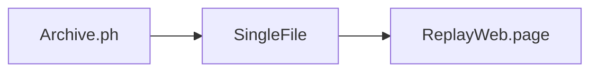
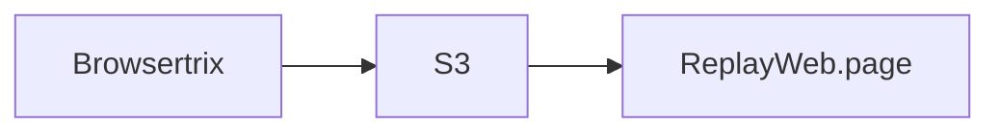
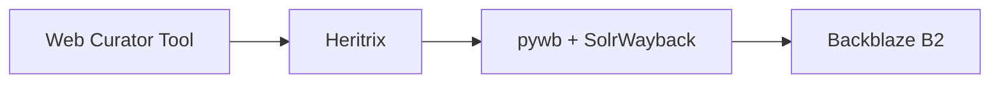
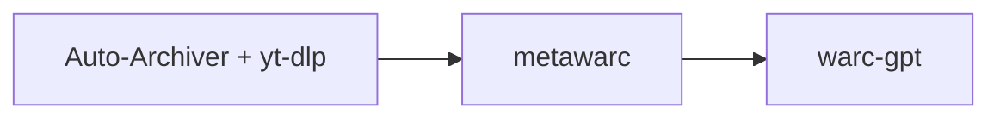
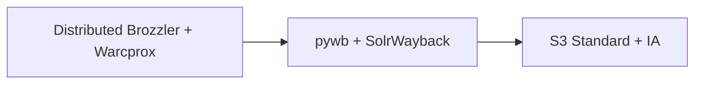
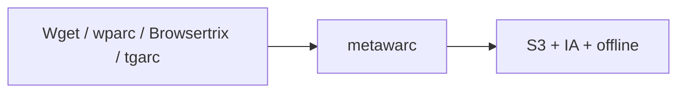

# Ландшафтная карта веб-архивации 2026

Состояние области на конец 2026 года. Ниже — попытка дать единую картину: какие инструменты существуют, кто их разрабатывает, что в активной разработке, что уходит в историю. Этот материал помогает выбрать правильный инструмент под конкретную задачу и не тратить время на легаси.

> **Принцип:** один инструмент закрывает одну задачу хорошо. Хороший архивный пайплайн — это **композиция** из 4–6 инструментов.

## Четыре столпа архивации

Любая архивная система делает четыре вещи:

```mermaid
flowchart LR
    subgraph Capture["CAPTURE · сбор"]
        direction TB
        C1["Browsertrix ⭐"]
        C2["wget · Heritrix"]
        C3["wparc ⭐"]
        C4["yt-dlp"]
    end
    subgraph Storage["STORAGE · хранение"]
        direction TB
        S1["pywb"]
        S2["S3 · R2"]
        S3["Backblaze"]
        S4["+ Internet Archive ⭐"]
    end
    subgraph Access["ACCESS · доступ"]
        direction TB
        A1["ReplayWeb.page ⭐"]
        A2["Wayback Machine"]
        A3["Perma.cc"]
        A4["Memento"]
    end
    subgraph Analysis["ANALYSIS · анализ"]
        direction TB
        N1["SolrWayback"]
        N2["metawarc ⭐"]
        N3["warc-gpt"]
        N4["DuckDB-warc"]
    end
    Capture --> Storage --> Access --> Analysis
```

Команда Ruarxive использует **Ruarxive-стек** (отмечен ⭐), остальное — стороннее.

## 1. CAPTURE — сбор контента

### Браузерные кроулеры (полная поддержка JavaScript)

| Инструмент | Язык | Хостинг | Особенности | Статус |
|:---|:---|:---|:---|:---|
| ⭐ [Browsertrix](/kb/instruments/tools/browsertrix) | Node.js + Chromium | Docker / Cloud | WACZ из коробки, поведения (autoscroll, autoplay) | **Стабильный** |
| [Squidwarc](/kb/instruments/tools/squidwarc) | Node.js + CDP | npm | Точное управление через DevTools Protocol | Стабильный |
| [Brozzler](/kb/instruments/tools/brozzler) | Python | Docker | Распределённый через Redis | Стабильный |
| [Warcworker](/kb/instruments/tools/warcworker) | Node.js | Docker | Squidwarc + очередь + UI | Стабильный |
| [Crocoite](https://github.com/crocoite/crocoite) | Python | pip | Скриншоты + DOM + WARC | Экспериментальный |
| [WAIL](https://github.com/machawk1/wail) | Python | GUI | One-click Heritrix + pywb | Нишевый |

### HTTP-кроулеры (без JavaScript)

| Инструмент | Язык | Формат | Статус |
|:---|:---|:---|:---|
| [Wget](/kb/instruments/tools/wget) | C | Файлы + WARC (1.14+) | **Стабильный** |
| ⭐ [Wpull](/kb/instruments/tools/wpull) | Python | Файлы + WARC | Стабильный |
| [Heritrix](/kb/instruments/tools/heritrix) | Java | WARC | **Стабильный** |
| [HTTrack](/kb/instruments/tools/httrack) | C++ | Зеркало | Стабильный |
| [grab-site](/kb/instruments/tools/grab-site) | Python | WARC | Стабильный |

### Специализированные загрузчики

| Инструмент | Для чего | Статус |
|:---|:---|:---|
| [yt-dlp](/kb/instruments/tools/yt-dlp) | Видео (1800+ сайтов) | **Стабильный** |
| [gallery-dl](/kb/instruments/tools/gallery-dl) | Изображения (200+ платформ) | **Стабильный** |
| [tdl](/kb/instruments/tools/tdl) | Telegram | Стабильный |
| ⭐ [tgarc](https://github.com/ruarxive/tgarc) | Telegram с метаданными | Стабильный |
| ⭐ [wparc](/kb/instruments/ruarxive-tools/wparc) | WordPress через REST API | Стабильный |
| ⭐ [ydiskarc](https://github.com/ruarxive/ydiskarc) | Яндекс.Диск | Стабильный |
| ⭐ [filegetter](/kb/instruments/ruarxive-tools/filegetter) | Массовое скачивание файлов | Стабильный |
| [Auto-Archiver (Bellingcat)](https://github.com/bellingcat/auto-archiver) | Workflow OSINT | Активно развивается |
| [twarc](/kb/instruments/social-media/twarc) | Twitter JSON | Только legacy v2 API |
| [fbarc](/kb/instruments/social-media/fbarc) | Facebook | Ограниченно (API заблокирован) |
| [Social Feed Manager](https://github.com/gwu-libraries/social-feed-manager) | Multiple platforms | Нишевый |

### Моментальное сохранение

| Инструмент | Для чего | Статус |
|:---|:---|:---|
| ⭐ [Archive.ph](https://archive.ph/) | URL → snapshot за 30 с | **Стабильный** |
| [SingleFile](/kb/instruments/tools/singlefile) | Страница → один HTML (Chrome ext + CLI) | Стабильный |
| [WebScrapBook](/kb/instruments/tools/webscrapbook) | Browser tree + экспорт WARC | Стабильный |
| [monolith](/kb/instruments/tools/monolith) | CLI one-HTML | Стабильный |
| [Obelisk](/kb/instruments/tools/obelisk) | Go CLI + REST API | Стабильный |

## 2. STORAGE — хранение

### Форматы

| Формат | Назначение | Инструменты | Статус |
|:---|:---|:---|:---|
| ⭐ [WARC](/kb/instruments/file-formats/warc) | Стандарт ISO 28500 / WARC 1.1 | Многие | **Стандарт** |
| ⭐ [WACZ](/kb/instruments/file-formats/wacz) | ZIP + CDXJ + метаданные | Browsertrix, ReplayWeb.page | **Стандарт 2024+** |
| [ARC](https://iipc.github.io/warc-specifications/) | Legacy предшественник WARC | warctools | Legacy |
| ⭐ [CDX/CDXJ](/kb/instruments/file-formats/cdx) | Индекс | pywb, cdxj-indexer | **Стандарт** |
| [ZIM](https://wiki.openzim.org/) | Офлайн-чтение через Kiwix | warc2zim, zimit | **Стандарт для Kiwix** |
| [BagIt](https://tools.ietf.org/html/rfc8493) | Упаковка для передачи | bagit-python | **Стандарт** |
| ⭐ [PREMIS](/kb/instruments/file-formats/premis) | Метаданные сохранности | metawarc, mediainfo | **Стандарт** |
| [METS](https://www.loc.gov/standards/mets/) | Структурные метаданные | Goobi, mets-reader | Нишевый |
| [IIIF](/kb/instruments/file-formats/iiif) | Изображения высокого разрешения | Mirador, cantaloupe | Нишевый |
| [PDF/A](/kb/instruments/file-formats/pdfa) | Долгосрочное хранение PDF | veraPDF | **Стандарт** |
| [SIARD](/kb/instruments/file-formats/siard) | Базы данных | dbptk | Нишевый |
| [MBOX](/kb/instruments/file-formats/mbox) | Email-архивы | Thunderbird, archivematica | **Стандарт** |
| [JP2](/kb/instruments/file-formats/jp2) | Изображения высокого разрешения | kakadu, OpenJPEG | Нишевый |

### Хранилища

| Решение | Когда использовать | Стоимость |
|:---|:---|:---|
| Локальный диск | Личный архив | $ |
| AWS S3 Standard | Горячий архив (частое чтение) | $23/TB/мес |
| Cloudflare R2 | Публичный архив (анлим egress) | $15/TB/мес |
| Backblaze B2 | Бюджетное хранение | $6/TB/мес |
| Selectel / Yandex Cloud | Хранение в РФ | от 990 ₽/мес/ТБ |
| Internet Archive | Дополнительная копия | Бесплатно (для некоммерческих) |
| ⭐ Ruarxive (Backblaze + offline) | Главное хранилище Ruarxive | Грантовое финансирование |

### Правило 3-2-1

Любой важный архив должен иметь:

- **3 копии** (две полные + одна удалённая);
- **2 разных носителя** (диск + облако, или два облака);
- **1 копия вне офиса** (offline-бэкап или удалённый облачный регион).

## 3. ACCESS — доступ

### Воспроизведение

| Инструмент | Тип | Когда | Статус |
|:---|:---|:---|:---|
| ⭐ [ReplayWeb.page](/kb/instruments/replay/replayweb-page) | Клиентский | Разовое открытие | **Стабильный** |
| ⭐ [pywb](/kb/instruments/replay/pywb) | Серверный | Публичный архив | **Стабильный** |
| [OpenWayback](/kb/instruments/replay/openwayback) | Серверный (Java) | Существующая JVM-инфра | Стабильный |
| [IPWB](/kb/instruments/replay/ipwb) | Распределённый (IPFS) | P2P-доступ | Экспериментальный |
| [warc2html](/kb/instruments/replay/warc2html) | Конвертер | Для публикаций | Нишевый |
| ⭐ [Memento](/kb/instruments/replay/memento) | Стандарт RFC 7089 | Универсальный API | **Стандарт** |
| [Wayback Machine](https://web.archive.org/) | Публичный сервис | Глобальный доступ | **Стабильный** |

### Discovery и поиск

| Инструмент | Когда | Статус |
|:---|:---|:---|
| [Shine](/kb/instruments/tools/shine) | Полнотекстовый поиск, до 100 ГБ | **Стабильный** |
| [SolrWayback](/kb/instruments/tools/solrwayback) | Полнотекстовый поиск, от 100 ГБ | **Стабильный** |
| [ArchiveSpark](https://github.com/helgeho/ArchiveSpark) | Spark-кластер | Нишевый |
| [Warclight](https://github.com/archivesunleashed/warclight) | Blacklight-фронтенд | Нишевый |

### Постоянные ссылки

| Сервис | Когда | Статус |
|:---|:---|:---|
| [Perma.cc](/kb/similar/perma-cc) | Научное цитирование | **Стабильный** |
| [Wayback Machine](https://web.archive.org/save/) | Все случаи | **Стабильный** |
| [Archive.ph](https://archive.ph/) | Моментальное сохранение | **Стабильный** |

## 4. ANALYSIS — анализ

### Обработка и обогащение

| Инструмент | Что делает | Статус |
|:---|:---|:---|
| ⭐ [metawarc](/kb/instruments/ruarxive-tools/metawarc) | DuckDB-индекс + метаданные | **Стабильный** |
| ⭐ [metawarc-mcp](/kb/instruments/ruarxive-tools/metawarc-mcp) | MCP-сервер для LLM | **Стабильный** |
| [warc-processing](/kb/instruments/tools/warc-processing) | Библиотеки (warcio, jwarc) | **Стабильный** |
| [Warchaeology](/kb/instruments/tools/warchaeology) | Валидация, дедупликация | Стабильный |
| [Warcbench](https://github.com/harvard-lil/warcbench) | Исследование, трансформация | Экспериментальный |
| [DuckDB-warc](https://github.com/harvard-lil/duckdb-warc) | SQL к WARC | Активно развивается |
| [duckdb-web-archive-cdx](/kb/instruments/tools/duckdb-warc) | SQL к CDX IA/CC | Активно развивается |

### Защита и контроль качества

| Инструмент | Что делает | Статус |
|:---|:---|:---|
| [WARC-Safe](https://web.archive.org/web/2026/https://digital.library.unt.edu/ark:/67531/metadc2472470/) | Антивирус + NSFW | Стабильный |
| [warcvalid](https://github.com/iipc/jwarc) | Валидация WARC 1.1 | **Стабильный** |

### AI и RAG

| Инструмент | Что делает | Статус |
|:---|:---|:---|
| [WARC-GPT](https://github.com/harvard-lil/warc-gpt) | RAG по коллекции | Экспериментальный |
| [metawarc-mcp](/kb/instruments/ruarxive-tools/metawarc-mcp) | Интерфейс для LLM | Экспериментальный |
| [WARC-Bench](https://sanjari-orb.github.io/warc-bench/) | Бенчмарк для AI-агентов | Активно развивается |

### Link-graph анализ

| Инструмент | Что делает | Статус |
|:---|:---|:---|
| [Hyphe](https://github.com/medialab/hyphe) | Корпус-краулер с UI | Стабильный |
| [WebGraph](https://github.com/vigna/webgraph) | Графовый фреймворк | Нишевый |
| [Gephi](https://gephi.org/) | Визуализация графов | Стабильный |

## Что уходит в архив (Deprecated / Sunset)

| Инструмент | Что заменило | Примечание |
|:---|:---|:---|
| ArchiveTeam Warrior | Docker-сетапы | Сложно поддерживать |
| WAIL | Heritrix + pywb напрямую | Нет активной разработки |
| Shockwave Flash | HTML5 video | Не нужен с 2020 |
| Wayback Machine (старый) | pywb | IA перешёл на pywb к 2018 |
| Chromebot (ArchiveTeam) | ArchiveBot | Закрыт в 2020 |
| `ia wayback` (SavePageNow CLI) | Direct HTTP | Плохо поддерживается |

## Инициативы и сообщества

| Организация | Что делает |
|:---|:---|
| [IIPC](https://netpreserve.org/) | Стандарты (WARC, CDX), конференции, обучение |
| [Webrecorder](https://webrecorder.io/) | Browsertrix, ReplayWeb.page, pywb, WACZ-стандарт |
| [Internet Archive](https://archive.org/) | Wayback Machine, S3 API |
| [Bellingcat](https://www.bellingcat.com/) | OSINT-инструменты, Auto-Archiver |
| [Archive Team](http://www.archiveteam.org/) | Экстренные волонтёрские архивы |
| [Harvard Library Innovation Lab](https://lil.law.harvard.edu/) | WARC-GPT, Scoop, Perma.cc |
| [Royal Danish Library](https://www.kb.dk/en) | SolrWayback |
| [Common Crawl Foundation](https://commoncrawl.org/) | Открытые веб-краулы |
| [Rhizome](https://rhizome.org/) | Conifer, Web-арт сохранение |
| ⭐ [Ruarxive](https://ruarxive.org/) | Российские независимые СМИ + гос. сайты |

## Что добавили в 2024–2026

- **WACZ Signing Spec** — криптографическая подпись архивов (Scoop, wacz-signer).
- **DuckDB-warc** — SQL к WARC (Common Crawl, 2025).
- **duckdb-web-archive-cdx** — SQL к CDX IA/CC (2025).
- **WARC-GPT** — RAG к WARC-коллекциям (Harvard, 2025).
- **WARC-Safe** — антивирусная проверка (UNT, 2025).
- **Auto-Archiver** — workflow-оркестратор (Bellingcat, развивается).
- **Warchaeology** — набор утилит валидации (IIPC, 2025).

## Что ушло в 2024–2026

- **Conifer хостинг** (Rhizome) — закрыт в июне 2026 (legacy-самохостинг сохранён).
- **Wayback Machine свободный доступ** — ужесточение rate-limits с 2024.
- **Twitter v1.1 API** — окончательно сломан, twarc перешёл на v2.

## Как выбрать инструмент

### Для новичка (1–3 сайта)

### Для активиста (один сайт, регулярный сбор)

### Для университетской библиотеки

### Для OSINT-журналиста

### Для национального архива

### Для Ruarxive

## См. также

- [Программы и утилиты — обзор](/kb/instruments/tools)
- [Инструменты Ruarxive](/kb/instruments/ruarxive-tools)
- [Форматы файлов — обзор](/kb/instruments/file-formats)
- [Воспроизведение архивов](/kb/instruments/replay)
- [Wayback Machine API](/kb/instruments/tools/wayback-api)
- [WARC-файл: от сырого архива до публикации](/kb/guides/warc-workflow)
- [Ресурсы и сравнения](/kb/resources/comparisons)
