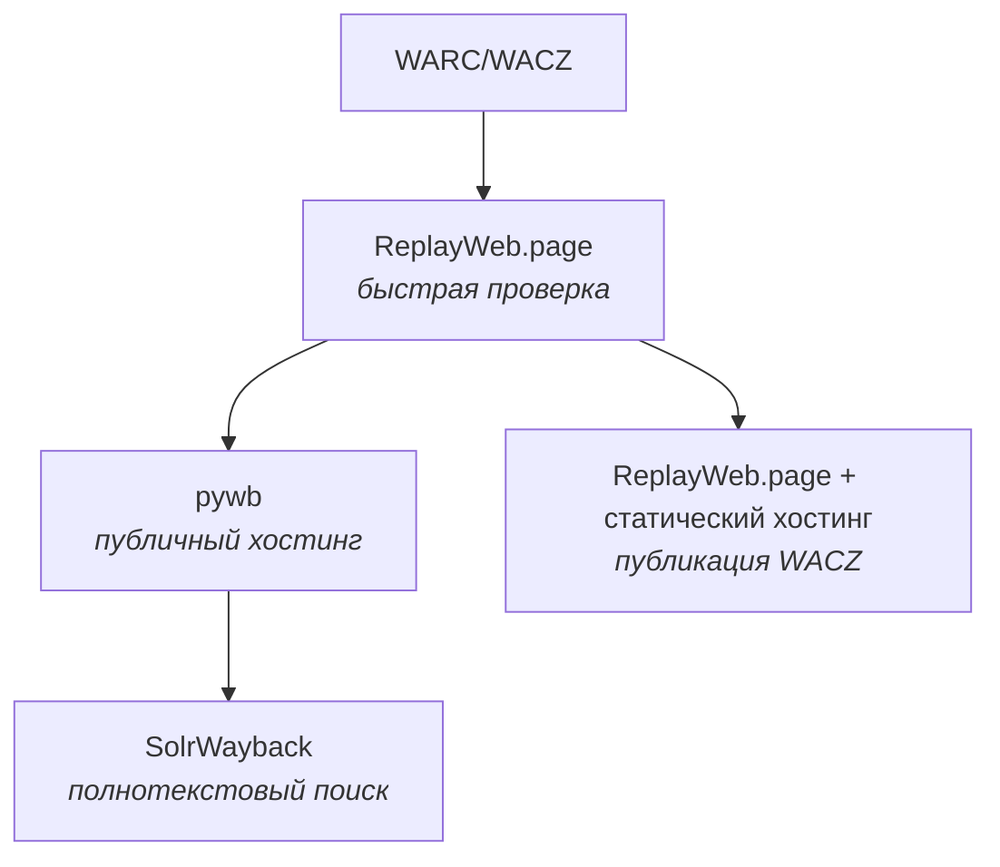

# Воспроизведение архивов

После того как архив записан в формате WARC или WACZ, его нужно сделать доступным для чтения. Просто открыть такой файл в браузере нельзя — это специальный контейнер с HTTP-ответами. Для просмотра используют так называемые **replay-системы**: они разворачивают локальный веб-сервер (или запускаются прямо в браузере), который отдаёт содержимое архива так, будто это живой сайт.

## Зачем нужны

* **Проверка качества** записанного архива: сразу видно, какие страницы поломались, где не загрузились изображения.
* **Доступ исследователям и читателям**: не нужно ставить себе специальное ПО, достаточно обычного браузера.
* **Сохранение ссылочной целостности**: replay-система переписывает ссылки так, чтобы навигация оставалась внутри архива.
* **Публикация**: исследователи и редакции получают постоянные ссылки на материалы.

## Как выбрать инструмент

### По сценарию и нагрузке

Ниже — ориентиры, а не измеренные пороги: многое зависит от числа файлов, индекса и железа.

| Сценарий | Рекомендация |
|:---|:---|
| Разово открыть файл, проверить качество | **[ReplayWeb.page](/kb/instruments/replay/replayweb-page)** (веб-версия или десктоп) |
| Опубликовать один или несколько WACZ без своего сервера | ReplayWeb.page + статический хостинг (S3, R2 и т. п.) |
| Личная или командная коллекция на своём сервере | **[pywb](/kb/instruments/replay/pywb)** |
| Крупная институциональная коллекция | pywb + внешний индекс [OutbackCDX](https://github.com/nla/outbackcdx) + nginx — именно такую связку описывает руководство IIPC по переходу с OpenWayback |

### По формату деплоя

| Сценарий | Инструмент | Почему |
|:---|:---|:---|
| Не нужно ничего ставить — открыл файл и смотришь | ReplayWeb.page | Полностью клиентский |
| Свой сервер с произвольным URL | pywb | Коллекции, CDX API, Memento |
| Уже есть установка OpenWayback | OpenWayback → план перехода на pywb | OpenWayback больше не развивается |
| Распространение через P2P / IPFS | IPWB | Хранение в IPFS |
| Статическая копия в виде обычных HTML-файлов | [warc2html](/kb/instruments/replay/warc2html) | Не нужен replay-сервер |
| Полнотекстовый поиск по большой коллекции | [SolrWayback](/kb/instruments/tools/solrwayback) | Индекс Solr + собственный replay |

### По требуемому функционалу

| Возможность | ReplayWeb.page | pywb | OpenWayback | IPWB |
|:---|:-:|:-:|:-:|:-:|
| **CDX API** (поиск снимков по URL) | ❌ | ✅ | ✅ (отдельный CDX-сервер) | ❌ |
| **Memento TimeGate/TimeMap** | ❌ | ✅ | ✅ | ✅ |
| **WARC / WACZ / ARC** | ✅ / ✅ / ❌ | ✅ / ⚠️ / ✅ | ✅ / ❌ / ✅ | ✅ / ❌ / ❌ |
| **Индексация** | WARC индексируется в браузере при загрузке, WACZ уже содержит индекс | `wb-manager add`, автоиндексация `wayback -a` | внешний CDX-индекс | `ipwb index` |
| **Полнотекстовый поиск** | ✅ для WACZ с извлечённым текстом | ❌ | ❌ | ❌ |
| **Несколько коллекций** | список загруженных архивов | ✅ | ✅ | ❌ (один индекс на запуск) |
| **Self-hosted** | ✅ статика (`ui.js` + `sw.js`) | ✅ | ✅ | ✅ (нужен узел IPFS) |
| **Статус проекта** | активно развивается | активно развивается | не развивается | поддерживается, базовый replay |

⚠️ pywb принимает WACZ через `wb-manager add --unpack-wacz`: WARC-файлы и индексы распаковываются в коллекцию.

## Подробный обзор инструментов

* **[ReplayWeb.page](/kb/instruments/replay/replayweb-page)** — браузерный replay без сервера. Лучший выбор для разовых просмотров, проверки и публикации WACZ на статическом хостинге.
* **[pywb](/kb/instruments/replay/pywb)** — основной серверный replay на Python от Webrecorder. IIPC рекомендует его как замену OpenWayback; на pywb основаны, например, системы UK Web Archive ([ukwa/ukwa-pywb](https://github.com/ukwa/ukwa-pywb)) и Arquivo.pt ([arquivo/pywb](https://github.com/arquivo/pywb)).
* **[OpenWayback](/kb/instruments/replay/openwayback)** — Java-реализация Wayback. Больше не развивается; для новых установок не рекомендуется.
* **[IPWB](/kb/instruments/replay/ipwb)** — replay через IPFS. Полезен для P2P-распространения, но требует работающего узла IPFS.
* **[warc2html](/kb/instruments/replay/warc2html)** — конвертация WARC в статические HTML-файлы с относительными ссылками.
* **[Memento](/kb/instruments/replay/memento)** — протокол «путешествий во времени» (RFC 7089), который поддерживают pywb, OpenWayback, IPWB и Wayback Machine.

## CDX и Memento

Серверные replay-системы обычно предоставляют два интерфейса:

- **CDX API** — запрос к индексу коллекции: список снимков URL с датой, MIME-типом, статусом, хешем. Это не формальный стандарт: у pywb, Wayback Machine и OpenWayback параметры и формат ответа различаются.
- **Memento (RFC 7089)** — стандарт IETF. TimeGate отдаёт снимок, ближайший к нужной дате; TimeMap возвращает список всех снимков URL.

Подробнее — на странице [pywb](/kb/instruments/replay/pywb) (разделы «CDX API» и «Memento») и в статье [Memento](/kb/instruments/replay/memento).

## Общий пайплайн: от записи до публикации

Типовые сценарии:

- **Экспресс-проверка качества** — после Browsertrix открываем WACZ в ReplayWeb.page.
- **Публикация для исследователей** — WACZ на объектном хранилище, ссылка вида `https://replayweb.page/?source=...`.
- **Публичный архив с постоянными URL** — pywb на своём сервере за nginx.
- **Поиск по содержимому большой коллекции** — SolrWayback (разработан Королевской библиотекой Дании).

Подробнее — [WARC-файл: от сырого архива до публикации](/kb/guides/warc-workflow) и [обработка WARC](/kb/instruments/tools/warc-processing).

## Связанные разделы

- [Формат WARC](/kb/instruments/file-formats/warc) — что внутри WARC и почему его нельзя открыть напрямую.
- [Формат CDX/CDXJ](/kb/instruments/file-formats/cdx) — формат индексов.
- [Программы и утилиты](/kb/instruments/tools) — браузерные краулеры (Browsertrix, Brozzler), которые пишут архивы.
- [Обработка WARC](/kb/instruments/tools/warc-processing) — обработка и переупаковка архивов.
- [Кейс: wparc → metawarc → индекс](/kb/case-studies/wparc-to-metawarc-pipeline) — конкретный пайплайн Ruarxive.
