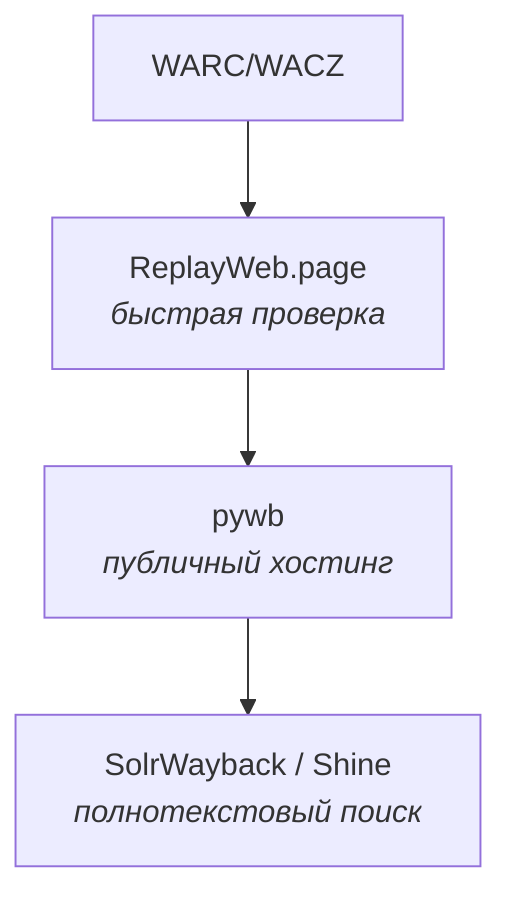

# Воспроизведение архивов

После того как архив записан в формате WARC или WACZ, его нужно сделать доступным для чтения. Просто открыть такой файл в браузере нельзя — это специальный контейнер с HTTP-ответами. Для просмотра используют так называемые **replay-системы**: они разворачивают локальный веб-сервер (или запускаются прямо в браузере), который отдаёт содержимое архива так, будто это живой сайт.

## Зачем нужны

* **Проверка качества** записанного архива: сразу видно, какие страницы поломались, где не загрузились изображения.
* **Доступ исследователям и читателям**: не нужно ставить себе спец-ПО, достаточно обычного браузера.
* **Сохранение ссылочной целостности**: реплей-система переписывает ссылки так, чтобы навигация оставалась внутри архива.
* **Публикация для публики**: исследователи и редакции получают постоянные ссылки на материалы.

## Как выбрать инструмент

### По размеру и нагрузке

| Размер архива | Сценарий | Рекомендация |
|:---|:---|:---|
| < 1 ГБ | Разово открыть один файл, проверить качество | **[ReplayWeb.page](/kb/instruments/replay/replayweb-page)** |
| 1 – 50 ГБ | Личная коллекция или небольшой исследовательский проект (1–3 пользователя) | **ReplayWeb.page** (десктоп) или **[pywb](/kb/instruments/replay/pywb)** на одном VPS |
| 50 ГБ – 500 ГБ | Архив отдела, газеты, университета (5–50 пользователей) | **pywb** на выделенном сервере с nginx + Redis |
| 500 ГБ – 10 ТБ | Национальный архив, ежедневная нагрузка | **pywb** + CDN (CloudFront / Cloudflare) |
| > 10 ТБ | Archive-scale (Internet Archive, Common Crawl) | **OpenWayback** + Hadoop-стек |

### По формату деплоя

| Сценарий | Инструмент | Почему |
|:---|:---|:---|
| Не нужно ничего ставить — открыл файл и смотришь | ReplayWeb.page | Полностью клиентский |
| Свой сервер с произвольным URL | pywb | Поддержка всех форматов, CDX/Memento API |
| Уже есть Java-инфраструктура | OpenWayback | JVM-экосистема |
| Распространение через P2P / IPFS | IPWB | Распределённое хранение |
| Конвертация в одиночные HTML | [warc2html](/kb/instruments/replay/warc2html) | Без браузера |
| Огромные архивы (ТБ+) с полнотекстовым поиском | pywb + [SolrWayback](/kb/instruments/tools/solrwayback) или [Shine](/kb/instruments/tools/shine) | Полноценное discovery |

### По требуемому функционалу

| Возможность | ReplayWeb.page | pywb | OpenWayback | IPWB |
|:---|:-:|:-:|:-:|:-:|
| **CDX API** (поиск по всем URL) | ❌ | ✅ | ✅ | ❌ |
| **Memento TimeGate/TimeMap** | ❌ | ✅ | ⚠️ | ❌ |
| **WARC/WACZ/ARC** | ✅/✅/❌ | ✅/✅/✅ | ✅/❌/✅ | ✅/❌/❌ |
| **CDXJ-индексация на лету** | ❌ | ✅ | ❌ | ❌ |
| **Multiple collections** | через URL | ✅ | ✅ | ❌ |
| **Mixed-content (HTTP-страницы на HTTPS)** | ⚠️ | ✅ | ✅ | ⚠️ |
| **Анонтации в архиве** | ✅ | ❌ | ❌ | ❌ |
| **Self-hosted** | ✅ статика | ✅ | ✅ | ❌ нужен IPFS |
| **Production-ready** | ✅ | ✅ | ✅ | Эксперимент |

## Подробный обзор инструментов

* **[ReplayWeb.page](/kb/instruments/replay/replayweb-page)** — браузерный replay без сервера. Лучший выбор для разовых просмотров, отладки и офлайн-работы.
* **[pywb](/kb/instruments/replay/pywb)** — основной серверный replay на Python. Используется Internet Archive и большинством национальных веб-архивов. Полная поддержка CDX/Memento, WARC/WACZ/ARC, multi-collection.
* **[OpenWayback](/kb/instruments/replay/openwayback)** — Java-альтернатива pywb. Полезна там, где уже есть JVM-инфраструктура (исследовательские центры на Java).
* **[IPWB](/kb/instruments/replay/ipwb)** — распределённый replay через IPFS. Полезен для P2P-распространения, но требует IPFS-инфраструктуры.
* **[warc2html](/kb/instruments/replay/warc2html)** — конвертация в одиночные HTML-файлы. Подходит для отправки материалов в публикации, где нет браузера.

## CDX и Memento — стандарты протокола

Все серверные replay-инструменты поддерживают два ключевых протокола IIPC:

- **CDX API** — индекс всех URL в коллекции с метаданными (дата, тип, хеш, длина). Используется для: «дайте список страниц X», «дайте все версии Y за 2026 год».
- **Memento (RFC 7089)** — стандарт «time travel». TimeGate делает редирект к ближайшему снимку по дате; TimeMap возвращает список всех снимков URL.

Подробнее — на странице [pywb](/kb/instruments/replay/pywb) (раздел «CDX API»).

## Общий пайплайн: от записи до публикации

Реальные сценарии Ruarxive:

- **Экспресс-проверка качества** — после Browsertrix открываем WACZ в ReplayWeb.page.
- **Публикация для исследователей** — WACZ на S3, ReplayWeb.page по ссылке.
- **Публикация для сообщества** — pywb на VPS, домен playback.ruarxive.org.
- **Discovery для большой коллекции** — pywb + SolrWayback (Королевская библиотека Дании).

Подробнее — [WARC-файл: от сырого архива до публикации](/kb/guides/warc-workflow) и [обработка WARC](/kb/instruments/tools/warc-processing).

## Связанные разделы

- [Справочник форматов](/kb/instruments/file-formats/warc) — что внутри WARC и почему его нельзя открыть напрямую.
- [Формат CDX/CDXJ](/kb/instruments/file-formats/cdx) — формат индексов.
- [Программы и утилиты](/kb/instruments/tools) — браузерные кроулеры (Browsertrix, Brozzler), которые пишут архивы.
- [WARC-инфраструктура](/kb/instruments/tools/warc-processing) — обработка и переупаковка архивов.
- [Кейс: wparc → metawarc → индекс](/kb/case-studies/wparc-to-metawarc-pipeline) — конкретный пайплайн Ruarxive.
