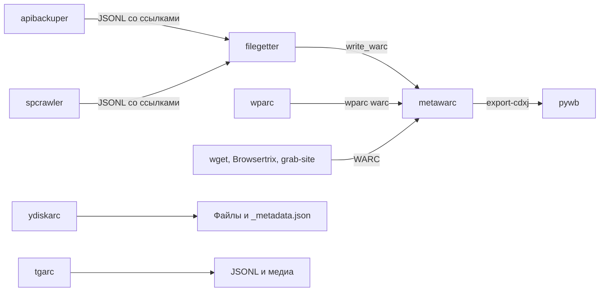

# Инструменты Ruarxive

Инструменты с открытым кодом, которые разрабатывает и поддерживает команда Ruarxive. Все они опубликованы на [github.com/ruarxive](https://github.com/ruarxive) под свободными лицензиями (MIT, Apache-2.0, у tgarc — CC0).

## Обзор по стадиям архивации

### 1. Сбор

Инструменты, которые **скачивают** данные и файлы.

| Инструмент | Что архивирует | Состояние |
| :--- | :--- | :--- |
| **[wparc](/kb/instruments/ruarxive-tools/wparc)** | Данные сайтов на WordPress через REST API `/wp-json/` | PyPI 1.0.8, в GitHub 1.0.9 |
| **[ydiskarc](/kb/instruments/ruarxive-tools/ydiskarc)** | Публичные файлы и папки Яндекс.Диска | PyPI 1.1.0 |
| **[filegetter](/kb/instruments/ruarxive-tools/filegetter)** | Файлы по ссылкам из CSV, JSONL или списка | PyPI 1.1.0 |
| **[apibackuper](/kb/instruments/downloaded-data/apibackuper)** | Данные из постраничных REST API | PyPI 2.0.0 (Python 3.10+) |
| **[spcrawler](/kb/instruments/downloaded-data/spcrawler)** | Метаданные публичных сайтов на SharePoint через `/_api/web` | PyPI 1.0.1 (2022), не развивается |
| **[tgarc](/kb/instruments/ruarxive-tools/tgarc)** | Сообщения и медиа каналов и чатов Telegram (JSONL) | Нет на PyPI, не развивается с 2023 года |

### 2. Обработка и анализ

| Инструмент | Что делает |
| :--- | :--- |
| **[metawarc](/kb/instruments/ruarxive-tools/metawarc)** | Индексирует WARC-коллекции в DuckDB + Parquet, извлекает метаданные PDF, OOXML и медиа, ищет по тексту, показывает сохранённые сайты (replay), даёт REST API и MCP-сервер. Сам WARC не создаёт |

Подробнее о metawarc: [REST API](/kb/instruments/ruarxive-tools/metawarc-rest), [MCP-сервер](/kb/instruments/ruarxive-tools/metawarc-mcp), [рецепты](/kb/instruments/ruarxive-tools/metawarc-cookbook), [экстракторы](/kb/instruments/ruarxive-tools/metawarc-extractors).

### 3. Мониторинг и данные

| Инструмент | Что делает |
| :--- | :--- |
| **[ruarxive-db](/kb/instruments/ruarxive-tools/ruarxive-db)** | Открытый каталог хранилища: коллекции, записи о ресурсах и ссылки на файлы в YAML, JSONL, Parquet и DuckDB. Из него строятся статистика и поиск «Есть ли сайт в архиве?» на главной странице |

## Что получается на выходе

| Инструмент | Результат | WARC | Python |
| :--- | :--- | :--- | :--- |
| **wparc** | JSONL по маршрутам API в `data/`, медиафайлы в `files/`; в 1.0.9 — ещё SQLite-индекс | `wparc warc` (1.0.9, только из GitHub): внутри JSON-ответы API, а не страницы сайта | 3.8+ |
| **ydiskarc** | Файлы со структурой папок и `_metadata.json` на каждом уровне (`sync`) или один ZIP (`full`) | Нет | 3.9+ |
| **filegetter** | Файлы в ZIP или каталоге, отчёт `processed.csv` с HTTP-статусом и SHA-256 | `write_warc = True` (нужен `filegetter[warc]`) | 3.9+ |
| **apibackuper** | Ответы API в хранилище (ZIP, SQLite или каталог); экспорт в JSONL, gzip, zstd, Parquet | Нет | 3.10+ |
| **spcrawler** | JSONL по разделам API SharePoint; файлы не скачивает | Нет | 3.6+ |
| **tgarc** | `messages.jsonl` и медиафайлы по каталогам | Нет | Не указана |
| **metawarc** | Каталог DuckDB с Parquet-сайдкарами; выгрузки файлов с `manifest.jsonl`; CDXJ для pywb | Читает, но не создаёт | 3.10+ |

## Как инструменты стыкуются



WARC из сборщиков Ruarxive пишут только `wparc warc` и filegetter с `write_warc = True`. Их metawarc индексирует вместе с WARC от краулеров. WARC от wparc содержит JSON-ответы API, поэтому pywb не покажет его как сайт. Результаты ydiskarc и tgarc, а также JSONL от apibackuper и spcrawler хранятся рядом с веб-архивом как есть.

Примеры конвейеров:

- [Архивация комплексных ресурсов](/kb/case-studies/multi-tool-archiving) — wparc, spcrawler, apibackuper и filegetter на одном учебном примере.
- [Пайплайн wparc → metawarc](/kb/case-studies/wparc-to-metawarc-pipeline) — выгрузка сайта на WordPress, упаковка в WARC, индексация и поиск.
- [Архивация через API](/kb/case-studies/api-archiving-scale) — apibackuper на государственных системах.

## Что когда использовать

| Задача | Инструмент |
| :--- | :--- |
| Проверить, не сохранён ли ресурс раньше | Поиск на [главной странице](https://ruarxive.org/) или **[ruarxive-db](/kb/instruments/ruarxive-tools/ruarxive-db)** |
| Выгрузить записи, страницы и медиа сайта на WordPress | **[wparc](/kb/instruments/ruarxive-tools/wparc)** |
| Скачать публичную папку с Яндекс.Диска | **[ydiskarc](/kb/instruments/ruarxive-tools/ydiskarc)** |
| Скачать файлы, ссылки на которые есть в наборе данных | **[filegetter](/kb/instruments/ruarxive-tools/filegetter)** |
| Сохранить данные из API с постраничной выдачей | **[apibackuper](/kb/instruments/downloaded-data/apibackuper)** |
| Сохранить Telegram-канал | Официальный [Data Take-Out](/kb/instruments/data-take-out/dto-telegram) или [tdl](/kb/instruments/tools/tdl); [tgarc](/kb/instruments/ruarxive-tools/tgarc) — только с учётом его статуса |
| Узнать, что внутри собранных WARC, и извлечь метаданные | **[metawarc](/kb/instruments/ruarxive-tools/metawarc)** |
| Найти фразу в тексте заархивированных HTML, PDF и OOXML | **[metawarc](/kb/instruments/ruarxive-tools/metawarc)** с `index-content --text` |
| Посмотреть сохранённый сайт локально | **[metawarc](/kb/instruments/ruarxive-tools/metawarc)** `serve` или [pywb](/kb/instruments/replay/pywb) |
| Дать доступ к коллекции дашборду или ИИ-агенту только на чтение | **[metawarc](/kb/instruments/ruarxive-tools/metawarc)** REST или MCP |

## Где применялись

| Инструмент | Кампания | Что сделано |
| :--- | :--- | :--- |
| apibackuper | [Coub](/kb/projects/coub), март 2022 | Ответы API и метаданные роликов Hot, Featured и 21 категории в JSONL |
| apibackuper | [Отчёты Счётной палаты](/kb/projects/government-campaigns-2022#отчёты-счётной-палаты), декабрь 2022 | 4,2 ГБ в сжатом виде, копия в Internet Archive; конфигурация `achgovru-checks` в [apibackuper-dataarchive](/kb/instruments/downloaded-data/apibackuper-configs) |
| metawarc | [Regnum и Росбалт](/kb/projects/russian-smi), ноябрь 2022 | Рядом с WARC этих сайтов лежат базы `metawarc.db` |

Не всё в архиве собрано инструментами Ruarxive. Сайты СМИ 2022 года снимал wpull, в том числе paperpaper.ru и agentura.ru, которые приводились как примеры при анонсе wparc. Каналы Telegram в 2022 году выгружены экспортом Telegram Desktop, а не tgarc. Порталы открытых данных собирали отдельными скриптами из репозитория [rudatarchive](https://github.com/ruarxive/rudatarchive).

## Установка

Рекомендуется ставить каждый инструмент в отдельное виртуальное окружение (например, через `pipx`).

```bash
# Сборщики с PyPI
pip install wparc ydiskarc filegetter apibackuper

# tgarc на PyPI нет — только из GitHub
pip install git+https://github.com/AduchiMergen/tgarc.git

# metawarc: базовый CLI
pip install metawarc

# metawarc с REST API и replay / с MCP-сервером / со всеми интерфейсами
pip install 'metawarc[api]'
pip install 'metawarc[mcp]'
pip install 'metawarc[all]'
```

Исходный код:

- [github.com/ruarxive/wparc](https://github.com/ruarxive/wparc)
- [github.com/ruarxive/ydiskarc](https://github.com/ruarxive/ydiskarc)
- [github.com/ruarxive/filegetter](https://github.com/ruarxive/filegetter)
- [github.com/ruarxive/apibackuper](https://github.com/ruarxive/apibackuper)
- [github.com/ruarxive/spcrawler](https://github.com/ruarxive/spcrawler)
- [github.com/ruarxive/tgarc](https://github.com/ruarxive/tgarc)
- [github.com/ruarxive/metawarc](https://github.com/ruarxive/metawarc)
- [github.com/ruarxive/ruarxive-db](https://github.com/ruarxive/ruarxive-db)

## Как устроены страницы раздела

1. **Что это** — назначение инструмента.
2. **Установка** — команды и версия, с которой сверялись примеры.
3. **Команды и примеры** — минимальный набор, чтобы получить результат.
4. **Формат результата** — что появится на диске.
5. **Ограничения** — чего инструмент не делает и какие есть известные проблемы.
6. **Связанные материалы**.

## Принципы

- **Открытый код** — все инструменты под свободными лицензиями.
- **Один инструмент — одна задача** — каждый решает узкий класс задач и стыкуется с остальными.
- **Повторный запуск без дублирования** — `filegetter` пропускает уже скачанные файлы, `wparc getfiles` ведёт список скачанного, `ydiskarc sync --update` докачивает только новые файлы, `apibackuper run continue` догружает недостающие страницы, а `apibackuper run --resume` и `metawarc index --resume` продолжают прерванный запуск.
- **Сбой не портит прежнюю копию** — apibackuper 2.0 пишет полную выгрузку во временное хранилище `.partial` и заменяет им прежнюю копию только после успешного сбора.
- **Исходники неизменны** — `metawarc` не трогает исходные WARC; каталог и сайдкары можно удалить и пересобрать.
- **Документация рядом с кодом** — у metawarc и apibackuper есть собственные сайты: [ruarxive.org/metawarc](https://ruarxive.org/metawarc/) и [ruarxive.org/apibackuper](https://ruarxive.org/apibackuper/).

## Ошибки и предложения

- **Ошибки и пожелания** — в Issues репозитория: [wparc](https://github.com/ruarxive/wparc/issues), [ydiskarc](https://github.com/ruarxive/ydiskarc/issues), [filegetter](https://github.com/ruarxive/filegetter/issues), [apibackuper](https://github.com/ruarxive/apibackuper/issues), [spcrawler](https://github.com/ruarxive/spcrawler/issues), [metawarc](https://github.com/ruarxive/metawarc/issues), [ruarxive-db](https://github.com/ruarxive/ruarxive-db/issues).
- **Правила участия** описаны в `CONTRIBUTING.md` у [metawarc](https://github.com/ruarxive/metawarc/blob/master/CONTRIBUTING.md), [wparc](https://github.com/ruarxive/wparc/blob/main/CONTRIBUTING.md) и [filegetter](https://github.com/ruarxive/filegetter/blob/main/CONTRIBUTING.md).
- **Уязвимости** не публикуйте в открытых Issues. Как о них сообщить, написано в `SECURITY.md` у [metawarc](https://github.com/ruarxive/metawarc/blob/master/SECURITY.md) (через приватный GitHub Security Advisory), [wparc](https://github.com/ruarxive/wparc/blob/main/SECURITY.md) и [apibackuper](https://github.com/ruarxive/apibackuper/blob/master/SECURITY.md).
- **Сайт, который может исчезнуть**, предложите через [запрос на архивацию](/kb/preserved-projects-form).

## Связанные разделы

- [Все инструменты (включая сторонние)](/kb/instruments)
- [Программы и утилиты](/kb/instruments/tools)
- [Загружаемые данные](/kb/instruments/downloaded-data) — apibackuper, его конфигурации и spcrawler
- [Социальные сети](/kb/instruments/social-media)
- [Справочник форматов](/kb/instruments/file-formats)
- [Гайды](/kb/guides)
- [Кейсы и истории](/kb/case-studies)
- [awesome-digital-preservation](https://github.com/ruarxive/awesome-digital-preservation) — список инструментов и сервисов цифровой сохранности, который ведёт Ruarxive; другие списки — в [каталогах «Awesome…»](/kb/similar/awesome-catalogs)
