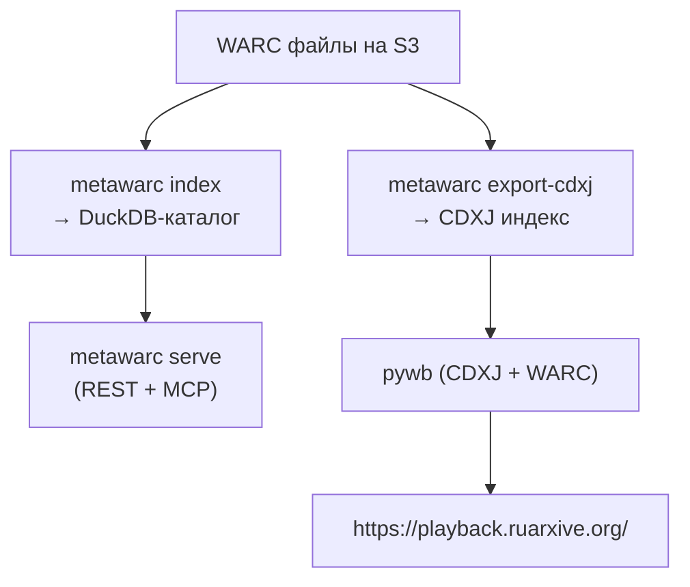

# metawarc cookbook — рецепты

Практические рецепты для типовых задач архивиста, журналиста и AI-агента. Каждый рецепт — пример команды + варианты конфигурации.

> **Полная документация metawarc** находится на [ruarxive.org/metawarc/use-cases](https://ruarxive.org/metawarc/use-cases). Здесь собраны **самые частые сценарии**, с которыми сталкивается команда Ruarxive.

---

## 1. Каталог всех PDF с метаданными в CSV

**Задача:** архивист собрал 300 ГБ WARC от партнёрских сайтов, нужно выгрузить список PDF-документов с метаданными (авторы, даты, число страниц) для документооборота.

```bash
# 1) Собрать метаданные
metawarc index-content --dbfile collection.db --kinds pdfs

# 2) Выгрузить через batch-job
curl -X POST -H "Authorization: Bearer $TOKEN" \
  -H 'Content-Type: application/json' \
  'http://127.0.0.1:8000/jobs' \
  -d '{
    "kind": "export-records",
    "format": "csv",
    "filter": {
      "mime": "application/pdf"
    },
    "limit": 5000
  }'
```

```bash
# 3) Скачать результат
curl -H "Authorization: Bearer $TOKEN" \
  'http://127.0.0.1:8000/jobs/job_xyz789/result' \
  -o pdf-catalog.csv
```

**Результат:**

```csv
record_id,url,title,author,pages,size_bytes
rec_1,https://example.com/q1-report.pdf,Квартальный отчёт,Иванов И.,45,1234567
rec_2,https://example.gov.ru/regulations.pdf,Регламент №234,Минфин,12,567890
...
```

**Альтернатива — через прямой DuckDB-запрос:**

```python
import duckdb

con = duckdb.connect("collection.db")
result = con.sql("""
    SELECT
        url, title, author, page_count
    FROM pdfs_metadata
    ORDER BY page_count DESC
    LIMIT 1000
""").df()

result.to_csv("pdf-catalog.csv", index=False)
```

---

## 2. Поиск по всем архивам (полнотекстовый)

**Задача:** исследователь ищет все упоминания «выборы 2026» в архиве за все годы.

### Подготовка

```bash
# Один раз: построить текстовый sidecar
metawarc index-content --dbfile collection.db --text --kinds pdfs,ooxmldocs,texts
```

Это может занять 30–60 минут на 1 млн записей.

### Поиск через CLI

```bash
metawarc search "выборы 2026" --limit 50 --language ru
```

### Поиск через MCP

```
Вы в Claude Desktop, спросите:
> Найди 20 последних упоминаний «выборы 2026» в коллекции.
```

Агент вызовет `search_records(query="выборы 2026", limit=20)`.

### Поиск через REST

```bash
curl -G -H "Authorization: Bearer $TOKEN" \
  'http://127.0.0.1:8000/records/search' \
  --data-urlencode 'phrase=выборы 2026' \
  --data-urlencode 'limit=50' \
  --data-urlencode 'language=ru'
```

**Ограничения:**

- Поиск работает только после `index-content --text`. Без этого sidecar результаты пустые.
- Backend — columnar scan (не FTS). Медленно для миллионов записей (> 5 с на запрос). Для production-полнотекста используйте [SolrWayback](/kb/instruments/tools/solrwayback).

---

## 3. Link graph (ссылочный граф) по доменам

**Задача:** для академического исследования построить граф «кто ссылается на кого» в собранном архиве региональной прессы.

### Извлечение ссылок

```bash
# Извлечь все ссылки из HTML в sidecar
metawarc index-content --dbfile collection.db --kinds links
```

### Экспорт ссылок и построение графа

```python
import duckdb
import networkx as nx

con = duckdb.connect("collection.db")

# Получить все ребра
edges = con.sql("""
    SELECT
        src.url AS source_url,
        regexp_extract(src.url, '://([^/]+)', 1) AS source_domain,
        dst.href AS target_url,
        regexp_extract(dst.href, '://([^/]+)', 1) AS target_domain
    FROM links_metadata dst
    JOIN archive_records src ON src.record_id = dst.src_record_id
    WHERE dst.rel IS NULL OR dst.rel NOT LIKE '%nofollow%'
""").df()

# Граф по доменам
G = nx.DiGraph()
for src, dst in zip(edges["source_domain"], edges["target_domain"]):
    if src and dst and src != dst:
        if G.has_edge(src, dst):
            G[src][dst]["weight"] += 1
        else:
            G.add_edge(src, dst, weight=1)

# Экспорт в Gephi
nx.write_gexf(G, "media-graph.gexf")

# Метрики
pagerank = nx.pagerank(G)
top10 = sorted(pagerank.items(), key=lambda x: x[1], reverse=True)[:10]
print("Top-10 доменов by PageRank:")
for domain, score in top10:
    print(f"  {score:.4f}\t{domain}")
```

Подробнее про link-graph: [Анализ ссылочного графа](/kb/guides/link-graph-analysis).

---

## 4. Инкрементальная индексация: каждый день новые WARC

**Задача:** архив ежедневно получает новые WARC-файлы; требуется поддерживать актуальный каталог без переиндексации всего.

### Pipeline

```bash
#!/bin/bash
# daily-metawarc-update.sh

DBFILE="/data/collection.db"
ARCHIVES_DIR="/data/new-archives/$(date -d 'yesterday' +%Y-%m-%d)"

# 1) Индексация только новых файлов (resume-safe)
metawarc index "$ARCHIVES_DIR/**/*.warc*" --dbfile "$DBFILE" --resume

# 2) Извлечение метаданных для новых PDF/OOXML
metawarc index-content --dbfile "$DBFILE" --kinds pdfs,ooxmldocs,links

# 3) Диагностика
metawarc doctor --dbfile "$DBFILE"

# 4) Статистика для дашборда
metawarc stats --dbfile "$DBFILE" --mode mimes | tee "$DBFILE.stats"

# 5) Экспорт обновлённого CDXJ для pywb
metawarc export-cdxj --dbfile "$DBFILE" -o /data/pywb-cdxj/

# 6) Перезапуск pywb
docker restart pywb-server
```

### Через cron

```cron
# Каждое утро в 04:00
0 4 * * * /opt/ruarxive/daily-metawarc-update.sh
```

**Особенности:**

- `metawarc index --resume` пропускает уже проиндексированные файлы благодаря хешу по содержимому.
- `index-content` всегда пересчитывает метаданные (быстро — секунды на 1000 записей).
- После `export-cdxj` нужно уведомить pywb — перезапуск или SIGHUP.

---

## 5. REST API для дашборда аналитики

**Задача:** команда журналистов делает дашборд статистики по архивам региона — React-приложение хочет показывать число PDF по доменам за каждый месяц.

### Backend (metawarc)

```bash
# С bearer-token
METAWARC_BEARER_TOKEN=secret metawarc serve --dbfile collection.db --host 127.0.0.1 --port 8000
```

### Frontend (React пример)

```jsx
import React, { useEffect, useState } from "react";

const API_BASE = "https://archive.example.org";
const TOKEN = process.env.REACT_APP_METAWARC_TOKEN;

function CollectionStats() {
  const [stats, setStats] = useState(null);
  const [loading, setLoading] = useState(true);

  useEffect(() => {
    async function loadStats() {
      const res = await fetch(`${API_BASE}/warcs/list`, {
        headers: { "Authorization": `Bearer ${TOKEN}` },
      });
      const data = await res.json();
      
      const res2 = await fetch(`${API_BASE}/records/list?limit=0`, {
        headers: { "Authorization": `Bearer ${TOKEN}` },
      });
      const records = await res2.json();
      
      setStats({
        archives: data.total,
        records: records.total,
        lastIndexed: data.items[0]?.indexed_at,
      });
      setLoading(false);
    }
    loadStats();
  }, []);

  if (loading) return <p>Загрузка...</p>;
  return (
    <div>
      <h2>Каталог архивов</h2>
      <p>Архивов: <strong>{stats.archives}</strong></p>
      <p>Записей: <strong>{stats.records.toLocaleString()}</strong></p>
      <p>Последнее обновление: <strong>{stats.lastIndexed}</strong></p>
    </div>
  );
}
```

### Frontend для поиска

```jsx
function SearchPage() {
  const [phrase, setPhrase] = useState("");
  const [results, setResults] = useState([]);

  async function search(e) {
    e.preventDefault();
    const res = await fetch(
      `${API_BASE}/records/search?phrase=${encodeURIComponent(phrase)}&limit=20`,
      { headers: { "Authorization": `Bearer ${TOKEN}` } }
    );
    const data = await res.json();
    setResults(data.hits);
  }

  return (
    <div>
      <form onSubmit={search}>
        <input value={phrase} onChange={e => setPhrase(e.target.value)} />
        <button>Поиск</button>
      </form>
      <ul>
        {results.map(hit => (
          <li key={hit.record_id}>
            <a href={hit.url}>{hit.url}</a>
            <p>{hit.snippet}</p>
          </li>
        ))}
      </ul>
    </div>
  );
}
```

---

## 6. Batch-экспорт для ClickHouse / PostgreSQL

**Задача:** ночной ETL забирает все новые HTTP-200 ответы за сегодня и кладёт в ClickHouse для аналитики.

### Pipeline

```python
import requests
from clickhouse_driver import Client

API = "http://127.0.0.1:8000"
TOKEN = "secret-token"
CLICKHOUSE = Client("localhost")

# 1) Submit batch job
job = requests.post(
    f"{API}/jobs",
    headers={"Authorization": f"Bearer {TOKEN}"},
    json={
        "kind": "export-records",
        "format": "csv",
        "filter": {
            "status": 200,
            "from_date": "2026-11-09",
            "to_date": "2026-11-09",
        },
        "limit": 100000,
    },
).json()

job_id = job["job_id"]

# 2) Wait for completion
import time
while True:
    status = requests.get(
        f"{API}/jobs/{job_id}",
        headers={"Authorization": f"Bearer {TOKEN}"},
    ).json()
    if status["status"] == "completed":
        break
    if status["status"] in ("failed", "cancelled"):
        raise Exception(f"Job failed: {status}")
    time.sleep(5)

# 3) Download CSV
csv_response = requests.get(
    f"{API}/jobs/{job_id}/result",
    headers={"Authorization": f"Bearer {TOKEN}"},
)
with open("/tmp/today.csv", "wb") as f:
    f.write(csv_response.content)

# 4) Insert to ClickHouse
import csv
with open("/tmp/today.csv") as f:
    reader = csv.DictReader(f)
    CLICKHOUSE.execute(
        "INSERT INTO archive_records (*) VALUES",
        [tuple(row.values()) for row in reader],
    )
```

---

## 7. Поднять параллельно pywb и metawarc

**Задача:** для публичного доступа нужен WARC-реплеер (pywb), а для аналитики — каталог (metawarc). Оба работают с одними WARC-файлами.

### Архитектура



### Команды

```bash
# 1) Индексировать
metawarc index '/data/warcs/*.warc*' --dbfile /data/metawarc/db.db

# 2) Экспортировать CDXJ для pywb
metawarc export-cdxj --dbfile /data/metawarc/db.db -o /data/pywb/cdxj/

# 3) Запустить pywb
pywb --config config.yaml

# config.yaml (фрагмент)
# collections:
#   echo-msk:
#     index_paths: /data/pywb/cdxj/echo-msk/
#     archive_paths: /data/warcs/
```

**Преимущества:**

- Один источник WARC обслуживает два интерфейса.
- CDXJ обновляется через cron + перезапуск pywb.
- [DuckDB-WARC](/kb/instruments/tools/duckdb-warc) может работать параллельно с обоими.

---

## 8. Резервное копирование каталога

**Задача:** каталог metawarc — результат часов индексирования. Нужно страховаться от потери.

### Подход 1 — rsync после каждого `index`

```bash
#!/bin/bash
# backup-metawarc.sh

DBFILE=/data/metawarc/db.db
DATA_DIR=/data/metawarc/db.db.data
BACKUP_DIR=/backup/metawarc/$(date +%Y-%m-%d)

mkdir -p "$BACKUP_DIR"

# Копируем БД и sidecars
cp -p "$DBFILE" "$BACKUP_DIR/"
rsync -a "$DATA_DIR/" "$BACKUP_DIR/data/"

# Компрессия
tar czf "$BACKUP_DIR.tar.gz" -C "$BACKUP_DIR" .
rm -rf "$BACKUP_DIR"

# Можно в S3
aws s3 cp "$BACKUP_DIR.tar.gz" s3://mybucket/metawarc-backups/
```

### Подход 2 — через `metawarc doctor`

```bash
# Doctor автоматически делает бэкап при миграции схемы
metawarc doctor --dbfile collection.db --auto-backup
```

### Подход 3 — версионирование в git (для маленьких каталогов)

```bash
# Каталог до 100 МБ — можно в git
cd /data/metawarc
git init
echo "*.warc" >> .gitignore   # WARC-файлы отдельно
git add db.db db.db.data/
git commit -m "metawarc snapshot 2026-11-09"
```

---

## 9. Просмотр через replay (не pywb, а metawarc.serve)

**Задача:** разработчик хочет быстро открыть один WARC без поднятия pywb.

### Встроенный replay

```bash
# Запуск
metawarc serve --dbfile collection.db

# Доступ
http://127.0.0.1:8000/replay/         # каталог архивов
http://127.0.0.1:8000/replay/20260315102345mp_/https://example.com/article
```

### Альтернативы для просмотра без metawarc

| Задача | Лучший выбор |
|:---|:---|
| Одиночный WACZ | [ReplayWeb.page](https://replayweb.page/) |
| Публичный архив | [pywb](/kb/instruments/replay/pywb) с Nginx |
| Локальная разработка | `metawarc serve` |
| Edge-deployed | Self-hosted ReplayWeb |

---

## 10. Bulk index после копирования коллекции

**Задача:** перенесли коллекцию с одного диска на другой, нужно быстро переиндексировать.

```bash
# Сканировать и индексировать одной командой
metawarc index '/data/warcs/**/*.warc*' \
  --dbfile /data/metawarc/db.db \
  --resume \
  --workers 4

# workers=4 — параллельные потоки индексирования
# для 1 ТБ коллекции это даёт ~4-кратное ускорение на multi-core CPU
```

**Мониторинг прогресса:**

```bash
# В другом терминале
watch -n 5 "metawarc stats --dbfile /data/metawarc/db.db | head -20"
```

---

## 11. Найти все редиректы (3xx записи)

**Задача:** исследование «куда ведут мёртвые ссылки».

```python
import duckdb

con = duckdb.connect("collection.db")

redirects = con.sql("""
    SELECT
        url,
        http_status,
        http_location
    FROM archive_records
    WHERE http_status BETWEEN 300 AND 399
    ORDER BY url
    LIMIT 1000
""").df()

print(redirects.head(20))
```

Или через REST:

```bash
curl -G -H "Authorization: Bearer $TOKEN" \
  'http://127.0.0.1:8000/records/list' \
  --data-urlencode 'status=301' \
  --data-urlencode 'limit=100'
```

---

## 12. Сравнение двух снимков страницы (diff WARC)

**Задача:** показать изменения на странице между двумя датами.

```python
import duckdb

con = duckdb.connect("collection.db")

# Найти все снимки конкретной страницы
record_id = con.sql("""
    SELECT record_id, warc_date
    FROM archive_records
    WHERE url = 'https://example.com/article'
    ORDER BY warc_date
""").df()

# Достать каждый payload
from warcio.archiveiterator import ArchiveIterator

payloads = []
for record_id_str in record_id["record_id"]:
    # metawarc REST API для скачивания
    import requests
    with requests.get(
        f"http://127.0.0.1:8000/records/get/arc_8a3b/data/{record_id_str}",
        headers={"Authorization": "Bearer secret"},
        stream=True,
    ) as r:
        payloads.append(r.content)

# Diff
from difflib import unified_diff
import re

# Извлекаем текст для более релевантного diff
def to_text(html):
    from bs4 import BeautifulSoup
    return BeautifulSoup(html, "html.parser").get_text()

text_v1 = to_text(payloads[0])
text_v2 = to_text(payloads[-1])

# Вывод diff
diff = unified_diff(
    text_v1.splitlines(), text_v2.splitlines(),
    fromfile="2026-03-15", tofile="2026-11-09",
    lineterm=""
)
print("\n".join(diff))
```

---

## Когда какой рецепт использовать

| Цель | Рецепт | Скорость |
|:---|:---|:---|
| Выгрузка PDF-каталога | **#1** | Slow (batch-job) |
| Полнотекстовый поиск | **#2** | Slow (columnar scan) |
| Link-graph | **#3** | Medium |
| Инкрементальное обновление | **#4** | Fast |
| Web-дашборд | **#5** | Fast (REST) |
| ETL в ClickHouse | **#6** | Slow (batch-job) |
| Публичный + аналитический | **#7** | Continuous |
| Backup | **#8** | Fast |
| Просмотр 1 архива | **#9** | Fast |
| Bulk index | **#10** | Slow |
| Audit редиректов | **#11** | Fast |
| Diff страницы | **#12** | Fast (2 запроса) |

## См. также

- [metawarc (главная)](/kb/instruments/ruarxive-tools/metawarc)
- [metawarc MCP](/kb/instruments/ruarxive-tools/metawarc-mcp)
- [metawarc REST API](/kb/instruments/ruarxive-tools/metawarc-rest)
- [Custom extractors](/kb/instruments/ruarxive-tools/metawarc-extractors)
- [DuckDB-WARC](/kb/instruments/tools/duckdb-warc)
- [WARC-workflow](/kb/guides/warc-workflow)
- [Кейс: wparc → metawarc](/kb/case-studies/wparc-to-metawarc-pipeline)
- [Ландшафт 2026](/kb/instruments/landscape-2026)
