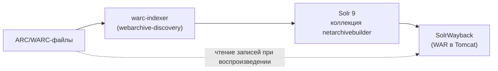

# SolrWayback

**SolrWayback** — веб-приложение для поиска и просмотра ARC/WARC-файлов, похожее на Wayback Machine Internet Archive, но с полнотекстовым поиском. Разрабатывается Королевской библиотекой Дании (проект netarchivesuite, ведущий разработчик — Thomas Egense), лицензия Apache-2.0. SolrWayback работает поверх сервера Apache Solr, в котором WARC-файлы проиндексированы инструментом `warc-indexer` из проекта [ukwa/webarchive-discovery](https://github.com/ukwa/webarchive-discovery) (его поддерживает Британская библиотека).

Сайт: [github.com/netarchivesuite/solrwayback](https://github.com/netarchivesuite/solrwayback)

## Зачем нужен

Пока WARC-файлы не проиндексированы, в них нельзя искать по словам, фильтровать по дате, домену и типу контента или строить статистику. SolrWayback превращает коллекцию WARC в поисковую систему с инструментами для исследователей.

Возможности (по README):

- полнотекстовый поиск по всем ресурсам: HTML, PDF, метаданным медиафайлов, URL;
- фасеты по домену, типу контента, году и другим полям Solr;
- **собственное воспроизведение** архивных страниц (API ссылок как у Wayback Machine: `/solrwayback/services/web/<timestamp>/<url>`); при желании можно подключить внешний движок воспроизведения, например pywb или OpenWayback;
- интерактивный граф ссылок между доменами и экспорт графов в формате Gephi;
- экспорт результатов поиска в WARC (потоково, без ограничения размера), в ZIP (файлы в исходных форматах) и в CSV с выбором полей;
- облако слов для домена, визуализация n-грамм по годам, статистика доменов во времени;
- поиск изображений по тексту, по геокоординатам из EXIF и по похожести (p-hash, PDQ);
- поиск по загруженному файлу: был ли он заархивирован и на каких страницах встречается;
- просмотр всех проиндексированных полей и WARC-заголовков записи;
- поддержка Memento API.

Демо: [webadmin.oszk.hu/solrwayback](https://webadmin.oszk.hu/solrwayback/) (Национальная библиотека Венгрии имени Сечени). Через SolrWayback открыт доступ и к ряду [коллекций IIPC](https://netpreserve.org/projects/collections-access/).

## Когда использовать

✅ Подходит для:

- исследовательских проектов по большой коллекции WARC;
- библиотек и архивов с собственным WARC-хранилищем;
- анализа связей между сайтами, трендов и тем.

❌ Не подходит для:

- нескольких WARC, которые нужно просто посмотреть: проще [ReplayWeb.page](/kb/instruments/replay/replayweb-page) или [pywb](/kb/instruments/replay/pywb);
- задач «в реальном времени»: индексация занимает время (по README — до 20 минут на 1 ГБ WARC).

## Архитектура



После индексации WARC-файлы должны оставаться на месте: SolrWayback читает из них записи при воспроизведении и экспорте.

## Установка

### Bundle (рекомендуемый способ)

Авторы рекомендуют начинать с готового пакета (bundle), в котором уже есть Solr, `warc-indexer` и SolrWayback в Tomcat. Последняя версия — [5.5.0](https://github.com/netarchivesuite/solrwayback/releases) (сентябрь 2026). Требования: Java 11 или 17; для превью страниц — Chrome или Chromium.

```bash
wget https://github.com/netarchivesuite/solrwayback/releases/download/5.5.0/solrwayback_package_5.5.0.zip
unzip solrwayback_package_5.5.0.zip
cd solrwayback_package_5.5.0

# файлы настроек — в домашний каталог
cp properties/solrwayback.properties properties/solrwaybackweb.properties ~/

# запуск Solr и Tomcat
chmod +x solrwayback_bundle.sh
./solrwayback_bundle.sh start
```

После запуска:

- интерфейс SolrWayback — `http://localhost:8080/solrwayback/`;
- Solr — `http://localhost:8983/solr/#/netarchivebuilder`.

Solr и Tomcat можно запускать и по отдельности: `solr-9/bin/solr start -c -m 4g` и `tomcat-9/bin/startup.sh`. Для индекса больше 100 млн записей README советует давать Solr 8–16 ГБ памяти.

### Индексация WARC

```bash
cd indexing
./warc-indexer.sh -h                 # справка
THREADS=2 ./warc-indexer.sh warcs1/*
```

Скрипт запоминает уже проиндексированные файлы (журналы в каталоге `status`), поэтому коллекцию можно пополнять: добавить WARC и запустить скрипт снова. Каждый поток индексации требует около 1 ГБ памяти; потоков не должно быть больше, чем ядер процессора. Новые документы видны в поиске с задержкой до 5 минут. Чтобы они появились сразу, откройте `http://localhost:8983/solr/netarchivebuilder/update?commit=true`.

Собственные коллекции задаются полями `collection`, `collection_id` и `institution`:

```bash
THREADS=4 INDEXER_CUSTOM="--collection-id collection1 --collection corona2021 --institution institution1" \
  ./warc-indexer.sh warcs1/*
```

В Windows используются скрипты `batch_warcs1_folder.bat`. Имена WARC-файлов лучше давать без пробелов: с ними на некоторых системах не работают превью и воспроизведение.

### Сборка из исходников

Проект собирается Maven:

```bash
git clone https://github.com/netarchivesuite/solrwayback
cd solrwayback
mvn package
# target/solrwayback-*.war развернуть в Tomcat 9+,
# скопировать properties/solrwayback.properties и properties/solrwaybackweb.properties в домашний каталог
```

Для этого нужен отдельный Solr 9+ с индексом от `warc-indexer` версии 3.2.0-SNAPSHOT или новее; про установку Solr Cloud — в [Extended Solr guide](https://github.com/netarchivesuite/solrwayback/blob/master/src/bundle/solr/SOLR.md).

### Docker

Готового официального образа в Docker Hub нет. В репозитории лежит пример [`Dockerfile`](https://github.com/netarchivesuite/solrwayback/blob/master/Dockerfile), который скачивает bundle и запускает Solr и Tomcat внутри контейнера (в нём зафиксирована версия bundle 5.1.2). Инструкции — в комментариях к файлу.

> Команды сверены с README и релизами репозитория netarchivesuite/solrwayback, версия 5.5.0 (октябрь 2026).

## Настройка

Настройки хранятся в двух файлах в домашнем каталоге:

- `solrwayback.properties` — адреса Solr и самого приложения (`wayback.baseurl`), путь к Chrome для превью (`chrome.command`, `screenshot.temp.imagedir`);
- `solrwaybackweb.properties` — интерфейс: начальный год для графиков (`archive.start.year`), логотип (`top.left.logo.image`), тексты «О коллекции», настройки карты, стоп-слова облака слов (`wordcloud.stopwords`, для русского языка их нужно заменить), фасеты.

После изменения настроек перезапустите Tomcat.

## Поиск

Запросы пишутся в синтаксисе Solr/Lucene. Подсказку по синтаксису и полям показывает кнопка «?» в строке поиска. Несколько примеров с полями схемы `warc-indexer`:

```text
"изменение климата"
выборы AND domain:example.ru
content_type_norm:pdf AND crawl_year:2022
title:отчёт AND crawl_date:[2022-01-01T00:00:00Z TO 2022-12-31T23:59:59Z]
```

В стандартной схеме `warc-indexer` текстовые поля используют общий анализатор `text_general` без морфологии конкретного языка. Поэтому поиск по русским словоформам без доработки схемы находит только точные формы слова (используйте `*`).

## Масштабирование

По README, отдельный Solr из bundle и скрипт `warc-indexer.sh` справляются примерно с 20 000 WARC-файлов по 1 ГБ. На 20 потоках индексация такой коллекции займёт до трёх недель, индекс получится около 1 ТБ (500 млн документов), Solr понадобится не меньше 12 ГБ памяти, а индекс нужно хранить на SSD. Для коллекций больше требуется Solr Cloud; распределённую индексацию поддерживает workflow archon/arctika из [netarchivesuite/netsearch](https://github.com/netarchivesuite/netsearch).

## Сравнение с другими инструментами

| Инструмент | Полнотекстовый поиск | Аналитика и графики | Воспроизведение | Сложность |
| :--- | :---: | :---: | :---: | :--- |
| **SolrWayback** | ✅ | ✅ | ✅ своё (можно подключить pywb) | Высокая: Java, Tomcat, Solr |
| **[pywb](/kb/instruments/replay/pywb)** | ❌ (поиск по URL) | ❌ | ✅ | Средняя |
| **[ReplayWeb.page](/kb/instruments/replay/replayweb-page)** | ⚠️ по страницам внутри WACZ | ❌ | ✅ | Низкая |
| **[Shine](shine)** | ✅ | ✅ | — | Архивный прототип, не развивается |

## Ограничения

- Тяжёлый стек: Java, Tomcat, Solr; индексация требует памяти и времени.
- Без доработки схемы нет морфологии для русского языка.
- При воспроизведении возможны «утечки» абсолютных ссылок на живой веб. README рекомендует проверять вкладку «Сеть» в инструментах разработчика или отключать интернет во время просмотра; для старых браузеров есть дополнительный root-servlet.

## Ресурсы

- [GitHub: SolrWayback](https://github.com/netarchivesuite/solrwayback) — исходный код и инструкция по bundle.
- [Wiki](https://github.com/netarchivesuite/solrwayback/wiki) — описание функций.
- [webarchive-discovery / warc-indexer](https://github.com/ukwa/webarchive-discovery) — индексатор.
- [Solr Reference Guide](https://solr.apache.org/guide/) — документация Solr.

## Связанные материалы

- **[pywb](/kb/instruments/replay/pywb)** — воспроизведение без поиска.
- **[Shine](shine)** — предшественник из UK Web Archive (архивный прототип).
- **[Обработка WARC](warc-processing)** — инструменты для работы с WARC.
- **[WARC-Safe](warc-safe)** — проверка коллекции на вирусы и NSFW; результаты можно добавить в Solr через netarchivesuite/warc-indexer.
- **[Browsertrix](browsertrix)** — для создания WARC.
- **[Формат WARC](/kb/instruments/file-formats/warc)**
- **[Формат CDX](/kb/instruments/file-formats/cdx)**
- **[Сравнения ресурсов](/kb/resources/comparisons)**
