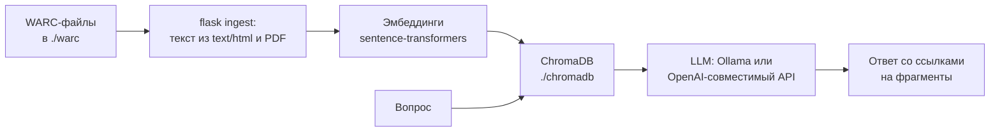

# WARC-GPT — LLM-интерфейс к веб-архивам

[WARC-GPT](https://github.com/harvard-lil/warc-gpt) — экспериментальный открытый инструмент [Harvard Library Innovation Lab](https://lil.law.harvard.edu/) (лицензия MIT) для работы с коллекциями WARC через большие языковые модели по схеме RAG (Retrieval-Augmented Generation). Репозиторий создан в октябре 2023 года, проект [анонсирован в блоге LIL 12 февраля 2024 года](https://lil.law.harvard.edu/blog/2024/02/12/warc-gpt-an-open-source-tool-for-exploring-web-archives-with-ai/). Последние изменения в репозитории — февраль 2025 года (версия 0.2.2): проект малоактивен.

> **Главное:** вы кладёте WARC-файлы в каталог, индексируете их, задаёте вопрос на естественном языке. Инструмент находит подходящие фрагменты страниц и передаёт их LLM вместе с вопросом, а модель отвечает со ссылками на источники.

Авторы прямо называют WARC-GPT экспериментом без гарантий уровня production.

## Как устроено



1. **Извлечение текста** из записей `response` с типом `text/html` (BeautifulSoup) и `application/pdf` (pypdf).
2. **Разбиение на фрагменты** по размеру контекстного окна модели эмбеддингов.
3. **Эмбеддинги** через модель sentence-transformers (по умолчанию `intfloat/e5-large-v2`, можно любую совместимую с Hugging Face).
4. **Хранение** в векторной базе ChromaDB (каталог `./chromadb`).
5. **Ответ**: вопрос → поиск ближайших фрагментов → LLM формирует ответ. Промпт просит модель ссылаться на источники по номеру или URL.

## Установка

Требования: Python 3.11+ и [Poetry](https://python-poetry.org/).

```bash
git clone https://github.com/harvard-lil/warc-gpt.git
cd warc-gpt
poetry env use 3.11
poetry install
```

Без Poetry:

```bash
python3 -m venv env
. env/bin/activate
pip install .
# в командах ниже убрать префикс "poetry run"
```

> Команды сверены с README и `.env.example` репозитория harvard-lil/warc-gpt, версия 0.2.2 (октябрь 2026).

## Настройка

Все настройки — переменные окружения в файле `.env`:

```bash
cp .env.example .env
```

Основные параметры:

| Переменная | Назначение |
|:---|:---|
| `OLLAMA_API_URL` | Адрес Ollama для локальных моделей (по умолчанию `http://localhost:11434`) |
| `OPENAI_API_KEY`, `OPENAI_ORG_ID` | Доступ к OpenAI API |
| `OPENAI_BASE_URL`, `OPENAI_COMPATIBLE_MODEL` | OpenAI-совместимый провайдер (например, vLLM или Hugging Face TGI) |
| `WARC_FOLDER_PATH` | Каталог с WARC (по умолчанию `./warc`) |
| `VECTOR_SEARCH_PATH` | Каталог ChromaDB (по умолчанию `./chromadb`) |
| `VECTOR_SEARCH_SENTENCE_TRANSFORMER_MODEL` | Модель эмбеддингов |
| `VECTOR_SEARCH_SENTENCE_TRANSFORMER_DEVICE` | `cpu`, `cuda` или `mps` |
| `VECTOR_SEARCH_SEARCH_N_RESULTS` | Сколько фрагментов возвращать (по умолчанию 4) |
| `TEXT_COMPLETION_*_PROMPT` | Тексты промптов |
| `API_*_RATE_LIMIT` | Ограничения частоты запросов к API |

Нужен хотя бы один источник моделей: Ollama или OpenAI (можно оба).

## Использование

### Индексация

Положите WARC-файлы в `./warc` и запустите:

```bash
poetry run flask ingest

# если не хватает памяти — по одному фрагменту за раз
poetry run flask ingest --batch-size 1
```

Каждый запуск `ingest` **очищает** каталог `./chromadb` и строит индекс заново.

### Веб-интерфейс и API

```bash
poetry run flask run            # http://localhost:5000
poetry run flask run --port 8000
```

В веб-интерфейсе есть простой чат с историей. REST API:

- `GET /api/models` — список доступных моделей;
- `POST /api/search` — поиск по векторной базе, тело `{"message": "..."}`; возвращает фрагменты с полями `warc_filename`, `warc_record_id`, `warc_record_date`, `warc_record_target_uri`, `warc_record_text`;
- `POST /api/complete` — ответ модели; поля `model`, `message`, а также необязательные `temperature`, `max_tokens`, `search_results` (результат `/api/search`), `history`. Возвращает текстовый поток.

```bash
curl -s -X POST http://localhost:5000/api/search \
  -H "Content-Type: application/json" \
  -d '{"message": "Какие меры объявлялись в марте 2020 года?"}'
```

### Визуализация эмбеддингов

```bash
poetry run flask visualize
poetry run flask visualize --questions="Кто автор?;О чём сайт?"
```

Строит интерактивную двумерную диаграмму T-SNE по векторной базе.

## Когда использовать

✅ Подходит:

- для исследовательских вопросов к небольшой или средней коллекции без SQL;
- для преподавания и демонстраций работы RAG на веб-архивах;
- для быстрой проверки гипотез с обязательной проверкой по ссылкам.

❌ Не подходит:

- для точных подсчётов и статистики: используйте [DuckDB-WARC](/kb/instruments/tools/duckdb-warc) или [metawarc](/kb/instruments/ruarxive-tools/metawarc);
- как юридическое доказательство: нужен доступ к самой архивной записи;
- для конфиденциальных коллекций с внешним API: текст фрагментов уходит провайдеру. Используйте локальные модели через Ollama.

## Ограничения и риски

- **Галлюцинации.** Модель может дать ответ, не основанный на источниках, или исказить цитату. Проверяйте каждый ответ по `warc_record_target_uri`.
- **Язык.** Модель эмбеддингов по умолчанию (`intfloat/e5-large-v2`) англоязычная. Для русских текстов разумно указать многоязычную модель, например `intfloat/multilingual-e5-large`. Результат зависит от модели, и его стоит проверить на своей коллекции.
- **Страницы на JavaScript.** Если текст страницы формировался скриптами и в WARC нет итогового HTML, извлекать нечего. Собирайте такие сайты браузерными кроулерами ([Browsertrix](/kb/instruments/tools/browsertrix)).
- **Только HTML и PDF.** Другие типы записей не индексируются.
- **Полная переиндексация.** Инкрементального добавления файлов нет.

## Альтернативы

| Инструмент | Подход |
|:---|:---|
| **[AnythingLLM](https://anythingllm.com/)** | Self-hosted RAG с интерфейсом для произвольных документов |
| **[PrivateGPT](https://github.com/zylon-ai/private-gpt)** | Локальный RAG без отправки данных во внешние сервисы |
| **[metawarc MCP](/kb/instruments/ruarxive-tools/metawarc-mcp)** | MCP-сервер Ruarxive для доступа LLM-агентов к каталогу WARC-коллекции |

## Ресурсы

- [WARC-GPT на GitHub](https://github.com/harvard-lil/warc-gpt)
- [WARC-GPT: An Open-Source Tool for Exploring Web Archives Using AI](https://lil.law.harvard.edu/blog/2024/02/12/warc-gpt-an-open-source-tool-for-exploring-web-archives-with-ai/) — анонс в блоге LIL, 12.02.2024
- [Документация ChromaDB](https://docs.trychroma.com/)
- [Ollama](https://ollama.com/)

## Связанные материалы

- [metawarc MCP](/kb/instruments/ruarxive-tools/metawarc-mcp)
- [DuckDB-WARC](/kb/instruments/tools/duckdb-warc) — SQL-запросы к WARC
- [Warchaeology](/kb/instruments/tools/warchaeology) — валидация и просмотр WARC
- [Ландшафт 2026](/kb/instruments/landscape-2026)
- [WARC-файл: формат](/kb/instruments/file-formats/warc)
- [metawarc](/kb/instruments/ruarxive-tools/metawarc) — каталог WARC-коллекций Ruarxive
