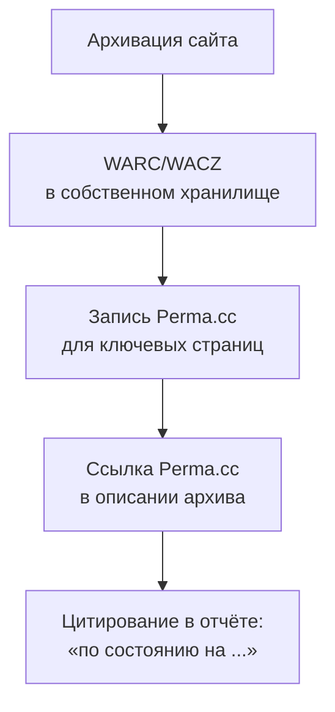

# Perma.cc — постоянные ссылки для научных публикаций

[Perma.cc](https://perma.cc/) — сервис постоянных ссылок для цитирования веб-страниц, созданный [Harvard Library Innovation Lab](https://lil.law.harvard.edu/) при Библиотеке Гарвардской школы права. Он используется академическим и юридическим сообществом для борьбы со **«ссылочным распадом»** (link rot) — когда через несколько лет страница, на которую сослался автор, исчезает или меняется.

> **Главная ценность:** Perma.cc широко используется для цитирования веб-источников в научных журналах и в судебных решениях США. Это удобный способ закрепить, на какую именно версию страницы ссылался автор; вопрос же допустимости архивной копии как доказательства суд решает в каждом деле отдельно — так же, как и для снимков Wayback Machine.

## Как работает

1. Пользователь создаёт учётную запись.
2. Сохраняет URL через [perma.cc](https://perma.cc/).
3. Получает постоянную ссылку вида `https://perma.cc/XXXX-YYYY`.
4. Цитирует эту ссылку вместе с оригинальной или вместо неё.

### Кто может пользоваться

- **Пользователи библиотек-партнёров (registrars)** — академических библиотек, судов и других организаций — пользуются сервисом бесплатно и без лимита в рамках своей организации.
- **Любой желающий** может зарегистрироваться и получить **10 пробных ссылок**. После этого нужна привязка к организации-партнёру или платная индивидуальная подписка.

### Что сохраняется

По данным [документации API](https://perma.cc/docs/developer), каждая запись содержит основной захват страницы и скриншот; архив можно скачать в форматах **WARC** и **WACZ** и открыть, например, в [ReplayWeb.page](https://replayweb.page/). У Perma.cc опубликован [план на случай прекращения работы](https://perma.cc/contingency-plan).

## Чем Perma.cc отличается от Wayback Machine

| Свойство | Perma.cc | Wayback Machine |
|:---|:---|:---|
| **Создание снимка** | По запросу пользователя | Автоматический обход и Save Page Now |
| **Контроль выборки** | Только то, что вы сохранили | Определяется краулером IA |
| **Назначение** | Цитирование в публикациях | Сохранение веба в целом |
| **Стоимость** | Бесплатно через партнёров, иначе — пробный лимит и подписка | Бесплатно для всех |
| **Доступ к записи** | Публичные и приватные записи | Публичный |
| **API** | ✅ | ✅ |

## Сценарии использования

### Сценарий 1. Научная статья

Автор хочет сослаться на веб-страницу, которая может измениться. Решение:

1. **При написании статьи** сохранить URL через Perma.cc.
2. **В тексте указать** `https://perma.cc/ABCD-1234` рядом с оригинальным URL.
3. **Рецензенты и читатели** увидят ту версию, на которую ссылался автор.

### Сценарий 2. Юридическое заключение

Юрист ссылается на публикацию, которая через несколько лет может исчезнуть: сохраняет её через Perma.cc в момент написания документа и приводит ссылку Perma.cc с датой создания записи.

### Сценарий 3. Журналистское расследование

Журналист цитирует публикацию в соцсети и сохраняет её через Perma.cc вместе со скриншотом — это позволяет показать, как выглядела публикация на момент цитирования.

### Сценарий 4. Подтверждение состояния страницы для архивного описания

Если нужно задокументировать, как выглядела страница до исчезновения:

1. Сохранить её через Perma.cc в день архивации.
2. Указать ссылку Perma.cc и дату в описании архива.
3. Хранить рядом контрольную сумму собственной копии (WARC/WACZ).

## Использование

### Через веб-интерфейс

1. Открыть [perma.cc](https://perma.cc/) и войти в учётную запись.
2. Вставить URL.
3. Получить `https://perma.cc/XXXX-YYYY`.

### Через API

Ключ API создаётся в разделе Settings → Tools; передаётся в заголовке `Authorization: ApiKey ...`.

```bash
API_KEY="your-api-key"

# Создать запись
curl -H "Authorization: ApiKey $API_KEY" \
  -H 'Content-Type: application/json' \
  -X POST -d '{"url": "https://example.com/article", "title": "Example article"}' \
  https://api.perma.cc/v1/archives/

# Получить сведения о записи
curl -H "Authorization: ApiKey $API_KEY" https://api.perma.cc/v1/archives/ABCD-1234/

# Скачать WARC и WACZ
curl -H "Authorization: ApiKey $API_KEY" -o record.warc.gz \
  https://api.perma.cc/v1/archives/ABCD-1234/download
curl -H "Authorization: ApiKey $API_KEY" -o record.wacz \
  'https://api.perma.cc/v1/archives/ABCD-1234/download?file_format=wacz'

# Список своих записей (постранично)
curl -H "Authorization: ApiKey $API_KEY" 'https://api.perma.cc/v1/archives/?limit=100' > perma-export.json

# Публичные записи — без ключа
curl 'https://api.perma.cc/v1/public/archives/?limit=1'
```

Распределение своих записей по годам:

```python
import json

with open("perma-export.json") as f:
    data = json.load(f)

years = {}
for obj in data["objects"]:
    year = obj["creation_timestamp"][:4]
    years[year] = years.get(year, 0) + 1

for year in sorted(years):
    print(f"{year}: {years[year]}")
```

Ответы постраничные: адрес следующей страницы — в поле `meta.next`.

> Запросы сверены с [документацией API Perma.cc](https://perma.cc/docs/developer) (октябрь 2026).

## Что происходит при исчезновении оригинала

Perma.cc хранит собственную копию страницы, поэтому ссылка остаётся рабочей и после исчезновения оригинала. Архив записи можно скачать в WARC или WACZ и открыть в ReplayWeb.page.

## Условия использования

- **Удаление и ограничение доступа** — правообладатель может обратиться через [perma.cc/contact](https://perma.cc/contact).
- **Приватные записи** — запись может быть скрыта от публичного просмотра (например, если сайт запрещает архивацию).
- **Авторские права** — Perma.cc создаёт копию чужого контента; правовые вопросы определяются законодательством США и условиями сервиса.

## Интеграция с Ruarxive

Ruarxive не дублирует Perma.cc, но его можно использовать для:

- **публикаций о сохранённых ресурсах** — ссылки на конкретные версии страниц;
- **документирования** — фиксация состояния страницы в момент архивации.

### Последовательность действий



## Когда использовать

✅ Подходит:

- **Научные публикации** о веб-ресурсах.
- **Ссылки в юридических документах** (прежде всего в США).
- **Журналистские расследования** с цитатами из веба.
- **Долгосрочные ссылки в библиографии.**

❌ Не подходит:

- **Массовая архивация** — для этого Wayback Machine или собственный архив.
- **Закрепление доказательств для российского суда** — суд оценивает доказательства по своему усмотрению; стандартный способ в РФ — нотариальный осмотр сайта (ст. 102–103 Основ законодательства РФ о нотариате).
- **Регулярный мониторинг** — Perma.cc сохраняет страницы только по запросу.

## Ресурсы

- [Perma.cc](https://perma.cc/) — главная.
- [Perma.cc API — документация](https://perma.cc/docs/developer)
- [План на случай прекращения работы](https://perma.cc/contingency-plan)
- [Harvard Library Innovation Lab](https://lil.law.harvard.edu/)

## Связанные материалы

- [Wayback Machine API](/kb/instruments/tools/wayback-api)
- [Internet Archive](/kb/similar/internet-archive)
- [Memento](/kb/instruments/replay/memento)
- [Авторское право](/kb/legal/copyright)
- [Кейсы: международные примеры](/kb/case-studies/international-examples)
- [Сравнения и лучшие практики](/kb/resources/comparisons)
