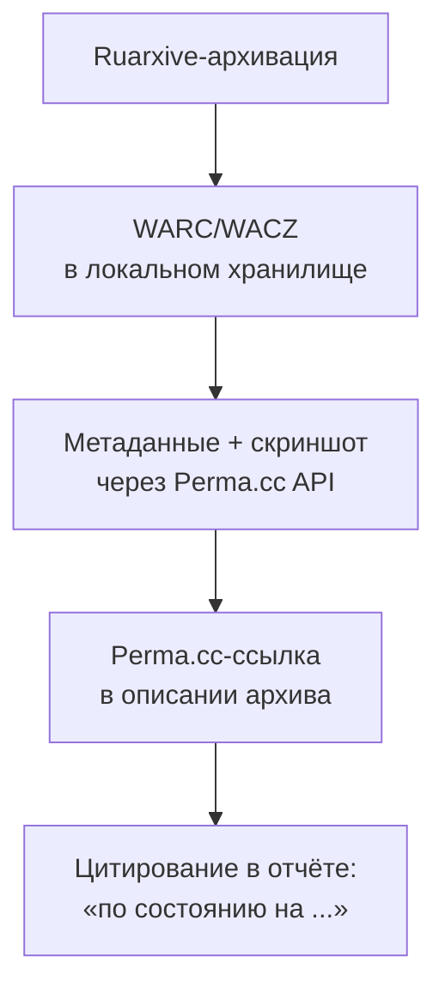

# Perma.cc — постоянные ссылки для научных публикаций

[Perma.cc](https://perma.cc/) — некоммерческий сервис долгосрочного цитирования веб-страниц, созданный в 2013 году [Гарвардской библиотекой](https://lil.law.harvard.edu/). Используется академическим и юридическим сообществом для борьбы с **«ссылочным распадом»** (link rot) — когда через несколько лет страница, на которую сослался автор, исчезает.

> **Главная ценность:** ссылки Perma.cc принимаются **судами как доказательства** в США. Это редкое свойство; большинство Wayback-ссылок суды относят к «вторичным доказательствам».

## Как работает

1. Юзер создаёт учётную запись (только академические и юридические организации).
2. Сохраняет URL через [perma.cc](https://perma.cc/).
3. Получает постоянную ссылку вида `https://perma.cc/XXXX-YYYY`.
4. Цитирует эту ссылку вместо оригинальной.

### Что под капотом

- **Скриншот** страницы + **WARC** + **HTML** + **JSON-метаданные**.
- Хранение на инфраструктуре Harvard Library + Internet Archive (двойная страховка).
- Криптографическая подпись записей.
- Поддержка **Memento** API.

## Что отличает Perma.cc от Wayback Machine

| Свойство | Perma.cc | Wayback Machine |
|:---|:---|:---|
| **Создание** | Вручную для конкретной нужды | Автоматически для всего |
| **Юридическая устойчивость** | ✅ Принимается судами | ⚠️ Вторичное доказательство |
| **Контроль выборки** | ✅ Только то, что вы сохранили | ❌ Курируется IA |
| **Академический фокус** | ✅ Создано для научных публикаций | ⚠️ Для всех |
| **Хеширование** | ✅ SHA-256 каждой страницы | ⚠️ Частично (WARC-Payload-Digest) |
| **Стоимость** | Бесплатно для академии | Бесплатно для всех |
| **Ограничения доступа** | Только авторизованные org | Публичный |
| **Memento** | ✅ | ✅ |
| **API** | ✅ Limited | ✅ Полный |

## Сценарии использования

### Сценарий 1. Научная статья

Автор хочет сослаться на web-страницу. Через год страница может измениться. Решение:

1. **При написании статьи** сохранить URL через Perma.cc.
2. **В тексте цитировать** `https://perma.cc/ABCD-1234` вместо оригинального URL.
3. **Ревьюеры и читатели** всегда увидят ту версию, на которую автор ссылался.

### Сценарий 2. Юридическое заключение

Юрист ссылается на интервью с подзащитным. Через несколько лет сайт может быть удалён.

- Сохранить через Perma.cc в момент публикации.
- В суде подать ссылку Perma.cc + сертификат даты создания.
- Суд примет как доказательство.

### Сценарий 3. Журналистское расследование

Журналист публикует материал с цитатами из Twitter-аккаунта.

- Использовать Perma.cc для скриншота + JSON с метаданными.
- Защита от обвинения в «фабрикации цитат».

### Сценарий 4. Судебное дело Ruarxive

Если материал нужен для подтверждения «сайт был такой-то до исчезновения»:

1. Сохранить через Perma.cc в день архивации.
2. Добавить PDF со скриншотом как доказательство.
3. Использовать дату Perma.cc + хеш для доказательства неизменности.

## Регистрация

### Для академических организаций

1. Перейти на [perma.cc/registration](https://perma.cc/registration).
2. Выбрать «Academic».
3. Указать:
   - Университет / НИИ / библиотеку.
   - Подтверждение email.
   - Тематику исследований.
4. Дождаться подтверждения (1–7 дней).

### Для юридических организаций

1. Аналогично, выбрать «Legal».
2. Подтвердить статус через bar registration или документ.

### Индивидуальные волонтёры

Perma.cc **не предоставляет регистрацию частным лицам**. Только институциональная. Решение для активистов — через партнёрские организации:

- Ряд библиотек дают «общий» вход для исследователей.
- Wayback Machine + ручное сохранение через скриншот с датой — альтернатива.

## Использование

### Сохранение страницы

#### Через UI

1. Открыть [perma.cc](https://perma.cc/).
2. Войти под учётной записью.
3. Вставить URL.
4. Получить `https://perma.cc/XXXX-YYYY`.

#### Через API

```bash
# Получить API key в личном кабинете
API_KEY="your-api-key"

# Сохранить URL
curl -X POST 'https://api.perma.cc/v1/archives/' \
  -H "Authorization: Bearer $API_KEY" \
  -H "Content-Type: application/json" \
  -d '{
    "url": "https://example.com/article",
    "title": "Example article"
  }'
```

Получить JSON:

```json
{
  "guid": "ABCD-1234",
  "url": "https://example.com/article",
  "title": "Example article",
  "description": null,
  "creation_timestamp": "20261109120000",
  "expiration_date": null,
  "wacz_size": 1234567,
  "status": "success"
}
```

#### Через Python (с библиотекой)

```python
from perma import Perma  # unofficial wrapper

p = Perma(api_key="your-key")
record = p.archive("https://example.com/article")
print(record["guid"])
```

### Программный поиск

```bash
# Найти записи организации
curl 'https://api.perma.cc/v1/user/archives/' \
  -H "Authorization: Bearer $API_KEY" | jq '.objects[] | {guid, url, creation_timestamp}'
```

### Memento API

Perma.cc поддерживает Memento:

```bash
# TimeGate
curl -I 'https://perma.cc/ABCD-1234'

# TimeMap
curl -H 'Accept: application/link-format' \
  'https://perma.cc/timemap/link/https://perma.cc/ABCD-1234'
```

## Форматы сохранения

Perma.cc сохраняет **четыре представления** страницы:

| Формат | Размер | Использование |
|:---|---:|:---|
| **Скриншот** | ~500 КБ | Визуальное доказательство |
| **WACZ** | ~2–100 МБ | Полное воспроизведение |
| **HTML source** | ~50 КБ | Текст-режим |
| **JSON-метаданные** | ~3 КБ | Header, response, headers, hash |

При экспорте все 4 формата объединяются в ZIP.

## Что происходит при исчезновении оригинала

**Perma.cc работает автономно**: внутри содержит полный WACZ-файл. Если оригинальная страница исчезает:

- Perma.cc-ссылка **остаётся рабочей**.
- Можно открыть через [ReplayWeb.page](https://replayweb.page/) — полная страница.
- PDF со скриншотом всегда доступен.
- Perma.cc продолжает хранить копию **бессрочно** для академических организаций.

## Программный экспорт для исследований

Perma.cc Community предоставляет публичный API для списков пользователей (с разрешения):

```bash
# Получить все архивы за период
curl 'https://api.perma.cc/v1/organization/<org_id>/archives/?limit=100' \
  -H "Authorization: Bearer $API_KEY" > perma-export.json
```

Затем:

```python
import json
with open("perma-export.json") as f:
    data = json.load(f)

# Распределение по годам
years = {}
for obj in data["objects"]:
    year = obj["creation_timestamp"][:4]
    years[year] = years.get(year, 0) + 1

for year in sorted(years):
    print(f"{year}: {years[year]}")
```

## Лицензия и условия использования

- **Хранение:** навсегда, по условиям партнёрства с Internet Archive.
- **Доступ:** пользователи Perma.cc могут получать свои архивы; другие — через публичные API.
- **Удаление:** правообладатель может потребовать takedown через [perma.cc/contact](https://perma.cc/contact).
- **Авторские права:** Perma.cc *создаёт копию*, поэтому ему также требуется лицензия/добросовестное использование.

## Программные ограничения

| API endpoint | Limit |
|:---|:---|
| Создать архив | 60 в минуту / 1000 в день |
| Чтение метаданных | нет |
| Скачать WACZ | 100 в час |
| Public archives lookup | 1000 в минуту |

Подробнее: [Perma.cc developers docs](https://perma.cc/docs/developer).

## Интеграция с Ruarxive

Ruarxive не дублирует Perma.cc, но может использовать его для:

- **Юридических доказательств** при takedown-процедурах.
- **Академических публикаций** команды о сохранённых ресурсах.
- **Сравнения версий** — если оригинальная страница изменилась за годы.

### Workflow



## Когда использовать

✅ Подходит:

- **Научные публикации** о веб-ресурсах.
- **Юридические доказательства** (для судов США).
- **Журналистские расследования** с цитатами.
- **Долгосрочные ссылки в библиографии**.
- **Подтверждение «что было на странице в момент X»**.

❌ Не подходит:

- **Массовая архивация** — для этого Wayback Machine или собственный архив.
- **Закрытые академические данные** — академический фокус это не гарантирует приватности.
- **Юридические системы вне США** — в ЕС/РФ не имеет доказательной силы.
- **Регулярный мониторинг** — Perma.cc ручной; нужны Ruarxive-инструменты.
- **Не-академические и не-юридические пользователи** — нет регистрации.

## Ресурсы

- [Perma.cc](https://perma.cc/) — главная.
- [Perma.cc для учёных](https://perma.cc/about)
- [Perma.cc API v1 docs](https://perma.cc/docs/developer)
- [Harvard LIL](https://lil.law.harvard.edu/) — родительская лаборатория.
- [Perma.cc + Wayback Machine comparison](https://lil.law.harvard.edu/blog/perma-cc-and-wayback-machine)

## Связанные материалы

- [Wayback Machine API](/kb/instruments/tools/wayback-api)
- [Internet Archive](/kb/similar/internet-archive)
- [Memento](/kb/instruments/replay/memento)
- [Правовые вопросы](/kb/legal/copyright)
- [Кейсы: международные примеры](/kb/case-studies/international-examples)
- [Сравнения и лучшие практики](/kb/resources/comparisons)
