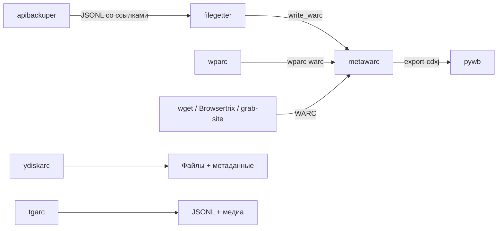

# Раздел «Инструменты Ruarxive»: ревизия и предложения

Дата: 2026-10-29. Объём: 10 страниц в `kb/instruments/ruarxive-tools/` и 4 страницы в `kb/instruments/downloaded-data/` (apibackuper и spcrawler — тоже инструменты Ruarxive), около 9 300 слов. Файлы в `kb/` не менялись.

Сверка: все 22 репозитория [github.com/ruarxive](https://github.com/ruarxive) (`gh repo list`), версии на PyPI, README и CHANGELOG репозиториев на 29.10.2026, коммиты с 05.10.2026.

Пометки: **[пров.]** — проверено в этой ревизии; **[сверить]** — нужно подтвердить по первоисточнику перед публикацией.

---

## 1. Главное

1. **Страницы отдельных инструментов полные и актуальные.** Версии совпадают с PyPI [пров.]: wparc 1.0.8, ydiskarc 1.1.0, filegetter 1.1.0, apibackuper 2.0.0, spcrawler 1.0.1, metawarc 2.0.3. Новых выпусков после 17.10.2026 нет. Про версии из GitHub (wparc 1.0.9, ydiskarc 1.2.0) написано верно. Ошибок в командах не найдено: выборочно сверены флаги, в том числе `wparc warc -o` (`wparc/core.py:265-270`).
2. **Не упомянуты два действующих репозитория организации.**
   - `russia-blocked`: мониторинг доступности российских госсайтов из-за рубежа и их сохранности в веб-архивах. Создан 19–20.10.2026, у него есть сайт [ruarxive.org/russia-blocked/](https://ruarxive.org/russia-blocked/). В `kb/` упоминаний нет [пров.].
   - `ruarxive-db`: каталог файлов хранилища, из него берётся статистика для главной страницы. Он упомянут на страницах проектов, но не в разделе инструментов [пров.].
3. **apibackuper и spcrawler не видны в сайдбаре раздела.** Они лежат в «Загружаемых данных». В таблице на обзорной странице сборщиков шесть, а в сайдбаре «Сбор данных» — четыре. При этом apibackuper — основной инструмент кампаний 2022 года, у него второе место по звёздам среди сборщиков (17).
4. **Обзорная страница описывает каждый инструмент, но не показывает, как они работают вместе.** Нет форматов результата: что пишет WARC, а что JSONL. Нет требований к Python и схемы конвейера. Нет ссылок на два кейса-конвейера (`multi-tool-archiving`, `wparc-to-metawarc-pipeline`). Нет примеров, где Ruarxive применял инструменты. Нет блока «как сообщить об ошибке».
5. **Соседняя страница противоречит разделу.** В `landscape-2026.md` нет apibackuper. Схема «Для Ruarxive» (`landscape-2026.md:305`) ставит tgarc перед metawarc. Но tgarc пишет JSONL, а не WARC, и на его странице прямо сказано: проиндексировать результат metawarc нельзя (`tgarc.md:99`).

---

## 2. Полнота: репозитории github.com/ruarxive и раздел

| Репозиторий | Что это | Последний push | В разделе | Где ещё на сайте | Предложение |
|---|---|---|---|---|---|
| `metawarc` | Индексация и анализ WARC | 2026-10-26 | Да, 5 страниц | landscape-2026, кейсы | — |
| `apibackuper` | Выгрузка постраничных API | 2026-10-17 | Только ссылка в таблице | downloaded-data, кейсы | Добавить в сайдбар раздела (§4) |
| `wparc` | WordPress через REST API | 2026-10-05 | Да | FAQ, кейсы | — |
| `ydiskarc` | Публичные папки Яндекс.Диска | 2026-10-26* | Да | — | — |
| `filegetter` | Файлы по спискам ссылок | 2026-10-07 | Да | кейсы | Мелкие дополнения (§6) |
| `spcrawler` | Публичный SharePoint | 2025-06-20 | Только ссылка в таблице | downloaded-data | Добавить в сайдбар раздела (§4) |
| `tgarc` | Telegram (форк) | 2023-12-15 | Да | social-media | — |
| **`russia-blocked`** | Ежемесячный мониторинг госсайтов | 2026-10-20 | **Нет** | **Нигде** | Новая страница (§5) |
| **`ruarxive-db`** | Каталог хранилища (YAML) | 2026-10-12 | **Нет** | projects | Абзац или страница в разделе (§5) |
| `awesome-digital-preservation` | Список инструментов (39 ★) | 2026-10-22 | Нет | similar, course | Ссылка в «Связанных разделах» |
| `apibackuper-dataarchive` | Конфигурации apibackuper | 2022-12-02 | Через downloaded-data | apibackuper-configs | — |
| `apibackuper-berlin-airport-example` | Пример apibackuper | 2022-04-29 | Нет | Нигде | Строка в apibackuper-configs |
| `apibackuper-example-spbbudget` | Пример apibackuper | 2022-02-10 | Нет | Нигде | Строка в apibackuper-configs |
| `coub-archival-campaign`, `rudatarchive`, `rugovinstagrams` | Код и данные кампаний 2022 | 2022 | Нет | projects | Блок «Где применялись» (§3.3) |
| `echomskru-archive`, `ikmo-archive` | Код кампаний 2022 | 2022 | Нет | Ссылок на репозитории нет | Ссылки со страниц проектов (вне раздела) |
| `preserve` | Заготовка набора инструментов (2022, пустой: 6 КБ) | 2022-04-14 | Нет | Нигде | Не упоминать |
| `ruarxive`, `ruarxive-research`, `preserved-russia`, `ruarxive.github.io` | Сайт и старые материалы | — | — | — | Не относится к разделу |

\* Push 26.10 — это ветки dependabot и snyk. Последний коммит в `main` сделан 05.10.2026 [пров.].

Инструменты, которые автор проекта публиковал вне организации (`undatum`, `metacrafter`, `newsworker` и другие), к Ruarxive не относятся. В разделе их нет, и это правильно. Если нужно, `undatum` можно упомянуть одной строкой как средство обработки JSONL после apibackuper, wparc и tgarc. Сейчас он упомянут только в `course/dh2-web-archiving.md`.

---

## 3. Обзорная страница `index.md`

### 3.1. Таблица «Сбор»: добавить формат результата и Python

| Инструмент | Результат | WARC | Python |
|---|---|---|---|
| wparc | JSONL по маршрутам API + медиафайлы | `wparc warc` (1.0.9, только из GitHub) | 3.8+ |
| ydiskarc | Файлы + `_metadata.json` или ZIP | Нет | 3.9+ (README; в метаданных PyPI указано `>=3.6`) |
| filegetter | ZIP или каталог + `processed.csv` с SHA-256 | `write_warc = True` | 3.9+ |
| apibackuper | ZIP, SQLite или каталог → JSONL, gzip, zstd, Parquet | Нет | 3.10+ |
| spcrawler | JSONL + файлы библиотек документов | Нет | 3.6+ (`setup.py`) |
| tgarc | JSONL + медиа | Нет | Не указан |

Столбец WARC сразу отвечает на частый вопрос: что потом можно проиндексировать metawarc и открыть в pywb.

### 3.2. Новый блок «Как инструменты стыкуются»

Схема Mermaid по образцу других страниц:



Под схемой — ссылки на кейсы, которые уже есть в базе знаний: [`multi-tool-archiving`](/kb/case-studies/multi-tool-archiving), [`wparc-to-metawarc-pipeline`](/kb/case-studies/wparc-to-metawarc-pipeline), [`api-archiving-scale`](/kb/case-studies/api-archiving-scale). Сейчас с `index.md` ведёт только общая ссылка на «Кейсы и истории».

### 3.3. Новый блок «Где применялись»

| Инструмент | Кампания | Источник |
|---|---|---|
| apibackuper | Coub, 2022 | `projects/coub.md:36` [пров.] |
| apibackuper | Госсистемы, 2022 (`apibackuper-dataarchive`) | `projects/government-campaigns-2022.md` [пров.] |
| apibackuper | Порталы открытых данных (`rudatarchive`) | `projects/open-data.md` [сверить, каким инструментом] |
| tgarc | Telegram-каналы, 2022–2023 | Не подтверждено. Выгрузки каналов СМИ 2022 года сделаны экспортом Telegram Desktop, а не tgarc (`projects/russian-smi.md:178`, `projects/echomsk.md:97`; выяснено в ревизии SM-2). Если других данных нет, строку не включать |
| wparc, ydiskarc | — | [сверить: есть ли коллекции в ruarxive-db] |

### 3.4. Другие правки в `index.md`

- **«Принципы» → «Повторный запуск без дублирования»:** добавить `ydiskarc sync --update` и `apibackuper update --resume`. Добавить, что apibackuper 2.0 пишет в `.partial` и не портит прежнюю полную копию (CHANGELOG 2.0.0) [пров.].
- **Новый блок «Сообщить об ошибке»:** ссылки на Issues репозиториев и на `CONTRIBUTING.md` (есть у wparc и filegetter). Открытые issues и PR на 29.10.2026: metawarc — 20, ydiskarc — 14, spcrawler — 11, wparc — 5, filegetter и apibackuper — по 1 [пров.].
- **«Связанные разделы»:** добавить [awesome-digital-preservation](https://github.com/ruarxive/awesome-digital-preservation) и `similar/awesome-catalogs`.
- **frontmatter `description`:** обновить после добавления russia-blocked и ruarxive-db.

---

## 4. Сайдбар

Сейчас (`sidebars.js:96-123`): обзор → «Сбор данных» (tgarc, wparc, ydiskarc, filegetter) → «Обработка и анализ» (5 страниц metawarc).

Предлагается:

```
Инструменты Ruarxive
├── Обзор                          ruarxive-tools/index
├── Сбор данных
│   ├── wparc
│   ├── ydiskarc
│   ├── filegetter
│   ├── apibackuper ↗              ref → downloaded-data/apibackuper
│   ├── spcrawler ↗                ref → downloaded-data/spcrawler
│   └── tgarc (не развивается)     в конец: проект неактивен
├── Обработка и анализ
│   └── metawarc + 4 подстраницы   без изменений
└── Мониторинг и данные            новая категория
    ├── russia-blocked             новая страница
    └── ruarxive-db                новая страница или раздел в index
```

Для apibackuper и spcrawler нужен элемент `{ type: 'ref', id: 'instruments/downloaded-data/apibackuper' }`. Он ставит ссылку на документ, но не переносит его. Адреса не меняются, хлебные крошки и «Назад/Вперёд» остаются в «Загружаемых данных». Плагина `client-redirects` в `docusaurus.config.js` нет [пров.], поэтому переносить файлы с новыми адресами не стоит.

---

## 5. Новые страницы

### 5.1. `russia-blocked`

По README [пров.]:

- **Что это:** ежемесячная проверка доступности значимых госсайтов из-за рубежа и, для сравнения, из российской сети. Плюс сохранность этих сайтов в Wayback Machine и Common Crawl. Данные с 2019 года, сайт на русском и английском, лицензия MIT.
- **Что проверяется:** DNS, ASN, TCP, TLS (включая Russian Trusted Root CA). Ответ главной страницы классифицируется: контент, JS-заглушка, WAF, страница блокировки, пусто, ошибка. Ещё проверяются WHOIS (раз в 90 дней), sparkline-API Wayback, годовые снимки Wayback и Common Crawl Host Index.
- **Реестр:** выборка из федеральной части [govdomains](https://github.com/infoculture/govdomains), около 7 700 хостов в источнике. Сколько хостов остаётся после фильтров — [сверить].
- **Команды:** `python -m rublocked registry | probe | whois | wayback | snapshots | commoncrawl | build | monthly`. Пакета на PyPI нет.
- **Метрика:** доли считаются по «когорте 2021 года» — сайтам, у которых в 2021 году был снимок с HTTP 200.

Где упомянуть, кроме раздела: `case-studies/government-websites-disappearing.md`, `case-studies/russia-resources-disappearing.md`, `projects/preserved-government.md`. Цифры с сайта мониторинга брать только с датой среза [сверить].

### 5.2. `ruarxive-db`

- **Что это:** YAML-база коллекций, записей и списков файлов хранилища. Собирается из экспорта Airtable и списков файлов SFTP (`scripts/merge_datasets.py`). Выпуск v1.0.0 — 14.12.2025, экспорт для сайта — 12.10.2026 [пров.].
- **Зачем в разделе инструментов:** это источник `src/data/archive-stats.json` и поиска по архиву на главной странице. Через него можно узнать, что уже сохранено. Отсюда полезный совет: перед новой кампанией проверьте каталог.
- **Объём:** коротко, на 200–300 слов. Отдельная страница или раздел в `index.md`.

---

## 6. Страницы: состояние и мелкие правки

| Страница | Слов | Код | Оценка | Что поправить |
|---|--:|--:|---|---|
| `index.md` | 538 | 1 | Средне | §3 |
| `metawarc.md` | 1 709 | 9 | Хорошо | На странице второй заголовок H1 `# Расширенные разделы` (`metawarc.md:145`). Сделать H2 или убрать разделитель |
| `metawarc-rest.md` | 1 230 | 16 | Хорошо | — |
| `metawarc-cookbook.md` | 763 | 17 | Хорошо | — |
| `metawarc-extractors.md` | 738 | 2 | Хорошо | — |
| `metawarc-mcp.md` | 688 | 7 | Хорошо | — |
| `filegetter.md` | 893 | 9 | Хорошо | Нет флага `--version` (CHANGELOG 1.1.0). Нет переменных `HTTP_PROXY`/`HTTPS_PROXY`/`NO_PROXY` (README, раздел появился 07.10.2026) — не добавлять: `CONTRIBUTING.md:99` запрещает советы про прокси. Нет ссылки на каталог `examples/` (`budget2023`, `goskatalog`, `rupolitparties`) [пров.] |
| `wparc.md` | 583 | 4 | Хорошо | Можно добавить `WPARC_DEBUG=1` для полных трассировок (`wparc/__main__.py`) [пров.] |
| `tgarc.md` | 581 | 3 | Хорошо | — |
| `ydiskarc.md` | 507 | 3 | Хорошо | — |
| `downloaded-data/apibackuper.md` | 863 | 5 | Хорошо | Версия 2.0 описана |
| `downloaded-data/apibackuper-configs.md` | 490 | 8 | Хорошо | Добавить репозитории `apibackuper-berlin-airport-example` и `apibackuper-example-spbbudget` (формат 1.x, [сверить]) |
| `downloaded-data/spcrawler.md` | 350 | 2 | Норма для неактивного | — |

Слова посчитаны без frontmatter и блоков кода.

Вне раздела:

- **`landscape-2026.md:80-90`:** добавить apibackuper (и spcrawler со статусом «не развивается») в таблицу сборщиков. Сейчас там из инструментов Ruarxive только tgarc, wparc, ydiskarc и filegetter.
- **`landscape-2026.md:305`:** убрать tgarc из цепочки «→ metawarc». Например: `Wget / wparc warc / filegetter / Browsertrix → metawarc`, а tgarc показать отдельной веткой в «JSONL».

---

## 7. План правок

| PR | Что | Файлы |
|---|---|---|
| RT-1 ✅ сделано 2026-10-29 | Сайдбар: `ref` на apibackuper и spcrawler, tgarc в конец. Категорию «Мониторинг и данные» добавить вместе со страницами в RT-3 и RT-4 | `sidebars.js` |
| RT-2 ✅ сделано 2026-10-29 | `index.md`: отдельная таблица «Что получается на выходе» (результат, WARC, Python; основная таблица не расширялась), схема конвейера и ссылки на кейсы, «Где применялись» (только подтверждённые случаи: wparc, ydiskarc и tgarc в кампаниях не найдены, rudatarchive — свои скрипты), «Ошибки и предложения», ссылка на awesome-список. Попутно исправлен `case-studies/multi-tool-archiving`: `spcrawler getfiles` — заглушка | `ruarxive-tools/index.md`, `case-studies/multi-tool-archiving.md` |
| RT-3 | Страница `russia-blocked` и ссылки на неё из кейсов | новая страница, 2–3 страницы кейсов и проектов |
| RT-4 ✅ сделано 2026-10-29 | Отдельная страница `ruarxive-db`, категория «Мониторинг и данные» в сайдбаре. Попутно найдено: в каталоге поле `tools` заполнено у 173 записей из 2 641 (wpull — 161, Telegram Desktop — 9), из инструментов Ruarxive — только apibackuper (Coub). Это подтверждает §3.3 | `ruarxive-tools/ruarxive-db.md`, `sidebars.js`, `index.md`, `projects/preserved-government.md` |
| RT-5 ✅ сделано 2026-10-29 | Мелкие правки: filegetter (`--version`, examples; прокси не добавлен — см. §6), H1 в metawarc, landscape-2026, примеры apibackuper. Примеры filegetter проверены `filegetter run --dry-run` (1.1.0), конфигурации apibackuper — `apibackuper validate-config` (2.0.0) | 4 файла |

Порядок: сначала RT-1 и RT-5 (быстро, без новых фактов), затем RT-2, затем RT-3 и RT-4 после сверки цифр.
